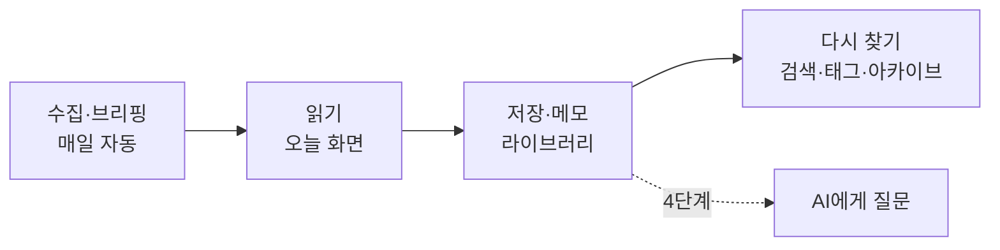

# 1. 프로젝트 개요

## 무엇을 하는 프로그램인가

**AI 브리핑(AI 조간)** 은 LLM·AI 에이전트 분야의 소식을 매일 자동으로 모아 한국어로 요약해 주는 Windows 상주형 데스크톱 앱입니다.

출근해서 PC를 켜면 트레이에 상주하던 앱이 그날의 브리핑을 만들고, 완료되면 알림을 띄웁니다. 알림을 누르면 신문 지면처럼 정리된 "오늘" 화면이 열립니다. 여기서 끝나지 않고, 쓸만한 기사를 저장하고 메모해서 **개인 AI 지식 저장소**로 쌓아 가는 것이 목표입니다.

## 주요 기능

| 기능 | 설명 |
|---|---|
| 매일 브리핑 | 뉴스·공식 블로그·논문·커뮤니티에서 수집 → 중복 합치기 → AI 선별 → 같은 소식 묶기 → 한국어 요약. 하루 17~18건, 1회 약 $0.01 |
| 자동 실행 | 로그인·잠금 해제(5시 이후) 또는 켜둔 채 오전 8시에 하루 한 번. 네트워크가 늦게 붙으면 최대 5분 기다림 |
| 오늘 화면 | 오늘의 한 줄, 섹션별 목록, 기사 패널(요약·핵심 포인트·왜 중요한가·같은 소식의 다른 출처) |
| 저장·메모 | 저장하면 원문 본문을 문단 단위로 보관하고 AI가 태그를 추천. 줄 노트 메모는 자동 저장 |
| 라이브러리 | 저장한 기사를 제목·요약·본문·메모로 검색, 메모 있는 기사·태그로 필터 |
| 아카이브 | 날짜별 지난 브리핑을 그날 지면 그대로 보기, 지금까지 실린 모든 기사 검색 |
| 비용 관리 | 월 예산(기본 $5)·하루 상한($0.5)·실행당 토큰 상한. 예산 도달 시 작은 모델로 바꾸는 절약 모드 |

## 수집 소스

`config/sources.yaml`에서 켜고 끌 수 있습니다.

| 분류 | 소스 |
|---|---|
| 랩 공식 블로그 | OpenAI, Google DeepMind, Google AI, Hugging Face (Anthropic은 RSS가 없어 꺼둠) |
| LLM 전문 블로그 | Simon Willison, Latent Space |
| 테크 뉴스 | TechCrunch, The Verge |
| 국내 커뮤니티 | GeekNews (관심 키워드에 맞는 글만) |
| 논문 | Hugging Face Daily Papers(추천수 포함), arXiv(에이전트·언어 모델 키워드 검색) |
| 커뮤니티 | Hacker News (키워드 검색, 60점 이상) |

## 기술 스택

| 영역 | 선택 |
|---|---|
| 앱 | Electron (Main · Worker · Renderer 3개 프로세스), TypeScript |
| 화면 | React + Vite + Tailwind CSS v4 (디자인 토큰은 `tokens.css`의 `@theme`) |
| DB | Node 내장 `node:sqlite` (FTS5 전문 검색 포함, 네이티브 모듈 빌드 불필요) |
| LLM | Groq — `openai/gpt-oss-20b`(선별·태그), `openai/gpt-oss-120b`(묶기·요약·머리글) |
| 수집·추출 | `rss-parser`, `@mozilla/readability` + `linkedom` |
| 테스트 | Vitest |

## 디자인: "조간 작업대"

신문 지면의 느낌(명조 제목, 괘선, 종이색, 이탤릭 원제, 강조색 하나)에 작업 도구의 3단 구성(메뉴 / 목록 / 기사 패널)을 합친 디자인입니다. 키보드만으로 훑고(J/K), 저장하고(S), 메모하고(M), 원문을 열(Enter) 수 있습니다. 색·크기는 모두 `src/renderer/src/styles/tokens.css`의 토큰으로만 씁니다.

## 진행 단계

| 단계 | 내용 | 상태 |
|---|---|---|
| 0. 사전 검증 | Electron 데스크톱 기능·네트워크 확인, 요약 모델 비교 | 완료 |
| 1. MVP | 수집 → 선별 → 요약 → 오늘 화면 | 완료 |
| 2. 자동 실행 | 트리거·알림·자동 시작, Windows 설치 파일 (낮 동안 미리 수집은 남음) | 대부분 완료 |
| 3. 저장·메모 | 본문 보관, 태그, 라이브러리, 아카이브, 검색 | 완료 |
| 4. AI 질문 | 기사·브리핑·라이브러리를 근거로 질문, 문단 인용 | 예정 |
| 5. 품질 | 선별·요약 품질 개선, 소스 확장 | 예정 |
| 6. 지식화 | 하이라이트, 라이브러리 RAG, 개인화, 내보내기 | 예정 |

## 문서 안내

- [2. 전체 아키텍처](02-architecture.md) — 프로세스와 계층, 폴더 구조
- [3. DB 구조](03-database.md) — 테이블과 관계, 검색 색인
- [4. 주요 비즈니스 흐름](04-business-flows.md) — 브리핑 생성, 저장·메모, 검색, 설정
- 설계 과정과 결정 기록은 루트의 [DESIGN.md](../DESIGN.md)
