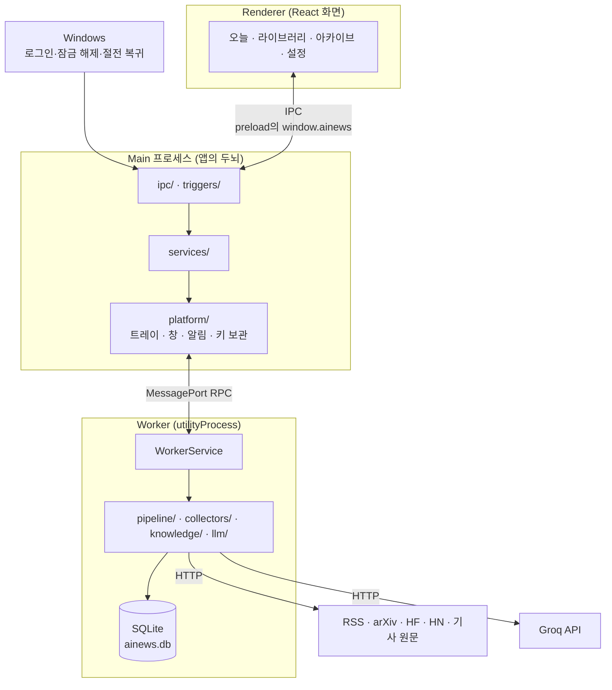
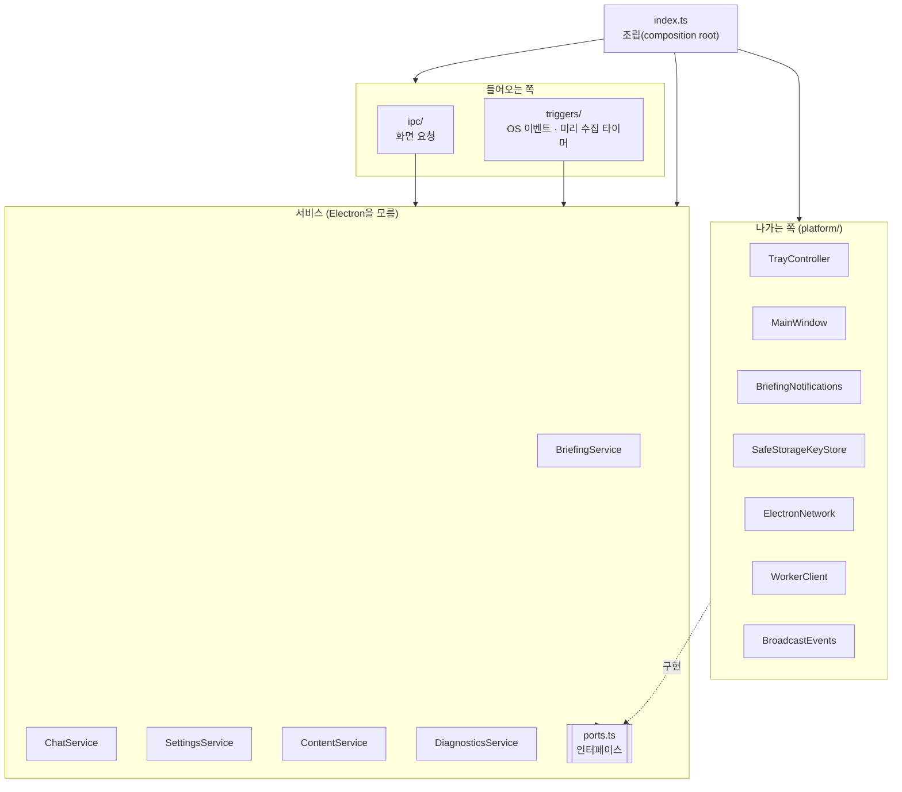
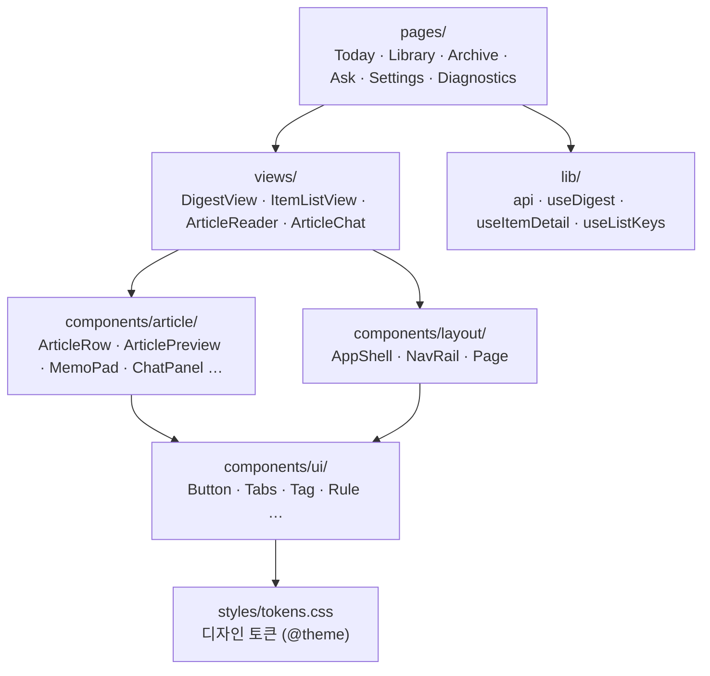

# 2. 전체 아키텍처

## 2.1 프로세스 구성

앱은 Electron의 세 프로세스로 나뉩니다. 무거운 일(수집·LLM·DB)은 Worker가 맡고, Main은 앱의 두뇌 역할만 하며, 화면(Renderer)은 Main을 통해서만 데이터를 받습니다.



| 프로세스 | 역할 | 진입점 |
|---|---|---|
| Main | 트레이·창·알림·단축키, 생성 시점 감지, 생성 흐름 제어, Worker 관리, 화면 요청 처리, API 키 암호화 보관 | `src/main/index.ts` |
| Worker | 수집, 중복 합치기, LLM 호출, 본문 추출, DB 읽기·쓰기. 죽으면 Main이 3초 뒤 다시 띄움 | `src/worker/index.ts` |
| Renderer | 화면. `contextIsolation`·`sandbox`로 격리되어 preload가 노출한 함수만 씀 | `src/renderer/src/main.tsx` |

**Worker를 따로 두는 이유:** 수집·LLM 호출·본문 추출처럼 오래 걸리는 일이 Main을 막으면 트레이와 창이 멈춥니다. 별도 프로세스로 떼어 두면 작업 중에도 화면이 반응하고, Worker가 비정상 종료돼도 앱은 살아 있습니다.

## 2.2 프로세스 사이의 통신

| 구간 | 방식 | 계약 정의 |
|---|---|---|
| Renderer ↔ Main | Electron IPC. Renderer는 preload가 노출한 `window.ainews`만 사용 | `src/shared/ipc.ts` (`IPC` 채널, `AinewsApi`) |
| Main ↔ Worker | utilityProcess 메시지. 요청마다 id를 붙인 RPC와, Worker가 먼저 보내는 알림(진행 상황·기사 갱신·로그) | `src/shared/worker-protocol.ts` (`WorkerApi`, `MainToWorker`, `WorkerToMain`) |

화면에서 시작한 요청은 항상 **Renderer → Main(ipc → service) → Worker(WorkerService → repo) → DB** 순서로 내려가고, 결과는 같은 길로 돌아옵니다. Worker에서 생긴 일(생성 진행 상황, 저장 후 태그 추천 완료, AI 답변 조각)은 반대로 **Worker → Main(`BroadcastEvents`) → 열려 있는 모든 창**으로 전달됩니다.

## 2.3 Main 프로세스 계층

Main은 네 계층으로 나뉘고, 의존은 한 방향으로만 흐릅니다.



| 계층 | 폴더 | 하는 일 | 규칙 |
|---|---|---|---|
| 들어오는 쪽 | `ipc/`, `triggers/` | 화면 요청·OS 이벤트를 받아 서비스를 부름 | 판단·저장 로직 없음, platform을 직접 부르지 않음 |
| 서비스 | `services/` | 앱이 하는 일 자체: 브리핑 생성 흐름, AI 질문, 설정, 콘텐츠 조회, 진단 | Electron을 import하지 않음. 바깥 기능은 `ports.ts`의 인터페이스로만 사용 |
| 나가는 쪽 | `platform/` | 포트의 실제 구현: 트레이, 창, Windows 알림, safeStorage, 네트워크 확인, Worker 호출, 화면 방송 | 상태는 클래스 안에 둠 |
| 조립 | `index.ts` | 위 객체들을 만들고 연결 | 로직 없음 |

이 구조 덕분에 서비스는 Electron 없이 가짜 포트로 단위 테스트합니다(`services/*.test.ts`).

## 2.4 Worker 구성

```mermaid
flowchart LR
  idx["index.ts<br/>메시지 수신"] --> svc["service.ts<br/>WorkerService (RPC 구현)"]
  svc --> run["pipeline/run.ts<br/>브리핑 생성"]
  svc --> enr["knowledge/enrich.ts<br/>저장 후 보강"]
  svc --> chat["knowledge/chat.ts<br/>AI 질문"]
  chat --> llm
  chat --> repo
  svc --> repo["db/repo.ts<br/>DB 접근"]
  run --> col["collectors/<br/>소스별 수집"]
  run --> sel["pipeline/select.ts<br/>점수·선정·묶기"]
  run --> llm["llm/<br/>Groq 호출·비용 기록"]
  run --> ext["knowledge/content.ts<br/>본문 확보"]
  run --> tr["knowledge/translate.ts<br/>본문 번역"]
  enr --> ext
  enr --> llm
  run --> repo
  enr --> repo
```



| 폴더 | 내용 |
|---|---|
| `collectors/` | 소스 종류별 수집기(RSS, HF Papers, arXiv, Hacker News·Show HN, GitHub 릴리스). 결과를 공통 형식(`RawItem`)으로 돌려줌 |
| `pipeline/` | 생성 파이프라인 전체(`run.ts`), URL·제목 정규화(`normalize.ts`), 점수·선정·묶기(`select.ts`, 순수 함수), LLM 출력 스키마(`schemas.ts`) |
| `knowledge/` | 기사 본문 추출(`extract.ts`), 본문 확보(`content.ts`: 추출하거나 수집한 글로 대신), 문단별 번역(`translate.ts`), 저장 후 본문 보관·태그 추천(`enrich.ts`), AI 질문(`chat.ts`), 인용 정리·문단 고르기(`citations.ts`) |
| `llm/` | Groq 호출과 구조화 출력·스트리밍(`groq.ts`), 실행 단위 토큰 상한·동시 호출 제한·사용량 기록(`service.ts`의 `LlmSession`), 단가·비용 계산(`pricing.ts`) |
| `db/` | 스키마와 마이그레이션(`schema.ts`), 연결(`db.ts`), 모든 SQL(`repo.ts`) |
| `config.ts` | `config/` 폴더의 YAML·프롬프트 읽기 |

`WorkerService`는 Electron에 의존하지 않습니다. Worker 프로세스의 메시지 처리는 `index.ts`가 맡고, 실제 기능은 모두 `WorkerService`에 있습니다.

## 2.5 화면(Renderer) 구성



| 계층 | 내용 |
|---|---|
| `pages/` | 화면 하나. `views`와 부품을 조합만 함 |
| `views/` | 여러 화면이 같이 쓰는 조합. `DigestView`(오늘·아카이브), `ItemListView`(라이브러리·아카이브 검색): 목록 + 옆 패널(개요) + 기사 읽기 화면(`ArticleReader`). `ArticleChat`(읽기 화면의 질문 단) |
| `components/article/` | 기사 관련 부품: 목록 행, 옆 패널 개요(`ArticlePreview`), 본문, 메모장, 태그, 질문 패널(`ChatPanel`) |
| `components/layout/` | 3단 틀, 메뉴, 단일 단 페이지 틀 |
| `components/ui/` | 기사를 모르는 기본 부품. 토큰 유틸리티만 사용 |
| `components/app/` | 진행 상황, 빈 화면, 오류 안내, 비용 표시, 목록 머리 |
| `lib/` | Main 호출(`api`), 브리핑 구독(`useDigest`), 기사 상세 구독(`useItemDetail`), 대화·답변 스트리밍(`useChat`), 목록 단축키(`useListKeys`) |

## 2.6 폴더 구조 요약

```
ai-news/
├─ config/            수집 소스, 관심 키워드, 역할별 모델, 단가, 프롬프트
├─ src/
│  ├─ main/           Main 프로세스 (ipc · triggers · services · platform · diagnostics)
│  ├─ preload/        화면에 노출할 API (window.ainews)
│  ├─ worker/         Worker 프로세스 (collectors · pipeline · knowledge · llm · db)
│  ├─ renderer/       React 화면 (pages · views · components · lib · styles)
│  └─ shared/         세 프로세스가 같이 쓰는 타입·계약·생성 시점 규칙
├─ docs/              이 문서들
└─ DESIGN.md          설계 과정과 결정 기록
```

## 2.7 설정과 데이터 위치

| 대상 | 위치 |
|---|---|
| 동작 설정 | `config/sources.yaml`, `interests.yaml`, `models.yaml`, `pricing.yaml`, `quick-actions.yaml`, `prompts/*.md` (설치판은 설치 폴더의 `resources/config`) |
| 설치 파일 | `npm run dist` → `dist/Jogan-Setup-<버전>.exe` (설정: `electron-builder.yml`, 아이콘: `build/icon.png`) |
| 사용자 데이터 | `%APPDATA%\AINews\` — `ainews.db`(DB), `diagnostics.log`(진단 기록), `groq-key.bin`(암호화된 API 키) |
| 사용자 설정 | DB의 `settings` 테이블 (월 예산, 하루 상한, 브리핑 크기) |
