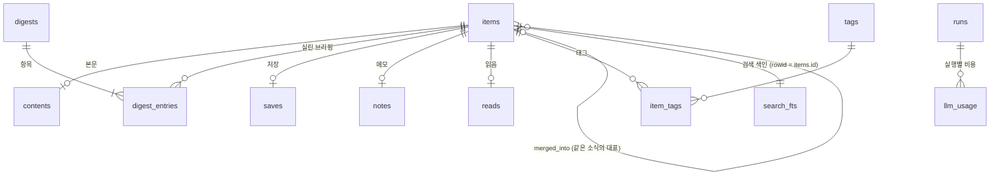

# 3. DB 구조

## 3.1 개요

- **엔진:** Node 내장 SQLite(`node:sqlite`). 파일은 `%APPDATA%\AINews\ainews.db` 하나입니다.
- **접근:** Worker 프로세스만 DB를 엽니다. 모든 SQL은 `src/worker/db/repo.ts`에 모여 있고, 다른 모듈은 SQL을 직접 쓰지 않습니다.
- **설정:** WAL 모드, 외래 키 사용, 잠금 대기 5초 (`src/worker/db/db.ts`의 `openDb`).
- **마이그레이션:** `src/worker/db/schema.ts`의 `MIGRATIONS` 배열을 `PRAGMA user_version`으로 관리합니다. 앱이 DB를 열 때 아직 적용하지 않은 마이그레이션을 앞에서부터 차례로 적용합니다. 이미 배포된 마이그레이션은 고치지 않고 새 항목을 뒤에 추가합니다.

| 버전 | 내용 |
|---|---|
| 1 | 1단계 MVP: 기사, 본문, 브리핑, 저장·메모·읽음, 실행 기록, LLM 사용량, 설정 |
| 2 | 같은 소식 묶기: `items.merged_into` |
| 3 | 기사별 "왜 중요한가": `items.why_ko` |
| 4 | 3단계: 태그, 저장 후 보강 표시(`saves.enriched_at`), 전문 검색 색인(`search_fts`) |

## 3.2 관계도

중심은 `items`(수집한 기사 한 건)입니다. 브리핑은 `digests`(하루 한 호)와 `digest_entries`(그 호에 실린 기사와 순위·섹션)로 이루어지고, 사용자의 동작(저장·메모·읽음·태그)은 모두 기사에 1:1 또는 1:N으로 붙습니다.

## 3.3 테이블

### items — 수집한 기사

기사 한 건의 원본 정보, LLM 선별 결과, 한국어 요약을 한 행에 담습니다.

| 열 묶음 | 열 | 설명 |
|---|---|---|
| 식별 | `id`, `url_key`(고유) | `url_key`는 정규화한 URL. 같은 글이면 같은 값 (arXiv abs·pdf·HF Papers는 모두 `arxiv:<id>`) |
| 원본 | `url`, `source_id`, `source_name`, `kind`, `title`, `snippet`, `lang`, `published_at`, `collected_at` | `kind`: news / paper / community / release |
| 중복 판정 | `title_norm` | 소문자·기호 제거한 제목. 최근 3일 안에 같은 제목이면 같은 기사로 봄 |
| 화제성 | `engagement`, `engagement_label` | HN 점수·HF 추천수 등 대표 참여도와 표시 문구("HN 747점") |
| 다른 출처 | `other_sources` | 같은 소식을 다룬 다른 출처 목록(JSON: 출처 이름·URL·참여도) |
| 같은 소식 묶기 | `merged_into` | 다른 기사의 대표로 합쳐졌으면 그 대표의 `id`. 값이 있으면 다음 후보에서 빠짐 |
| LLM 선별 | `triage_category`, `triage_relevance`, `triage_importance`, `triaged_at` | 분류, 관련도(0~1), 중요도(1~5). 한 번 매기면 다시 매기지 않음 |
| 한국어 요약 | `title_ko`, `summary_ko`, `key_points`, `why_ko`, `summary_model`, `summarized_at` | 한 번 요약하면 다시 요약하지 않음(비용 절감) |

### contents — 기사 본문

| 열 | 설명 |
|---|---|
| `item_id` (PK) | 기사 |
| `paragraphs` | 문단 목록(JSON). 문단 순서가 곧 화면의 ¶ 번호이고, 나중에 하이라이트와 AI 답변 인용의 기준이 됨 |
| `full_text` | 1이면 원문에서 본문을 추출함, 0이면 추출에 실패해 RSS 요약·논문 초록만 있음 |
| `extracted_at` | 추출 시각 |

본문은 두 시점에 채워집니다. 브리핑에 선정될 때(요약의 입력으로 쓰려고)와, 사용자가 저장할 때(보관하려고)입니다.

### digests / digest_entries — 브리핑

| 테이블 | 열 | 설명 |
|---|---|---|
| `digests` | `id`, `date`(고유), `headline`, `overview`, `stats`, `created_at` | 하루 한 호. 같은 날짜로 다시 만들면 내용을 바꿔 끼움. `stats`(JSON): 소스 수, 새로 수집한 수, 후보 수, 선정 수, 비용, 실패한 소스, 절약 모드 여부 |
| `digest_entries` | `digest_id`, `item_id`, `rank`, `section`, `why_it_matters` | 그 호에 실린 기사. `section`은 상위 5개면 `top`, 나머지는 분류 이름 |

### 사용자 동작

| 테이블 | 열 | 설명 |
|---|---|---|
| `saves` | `item_id`(PK), `saved_at`, `enriched_at` | 저장한 기사. `enriched_at`은 저장 후 본문 보관·태그 추천을 마친 시각 |
| `notes` | `item_id`(PK), `body`, `updated_at` | 기사별 메모. 메모를 쓰면 `saves`에도 자동으로 들어감. 빈 메모는 행을 지움 |
| `reads` | `item_id`(PK), `read_at` | 읽음 표시 (기사 패널에서 처음 열었을 때) |
| `tags` | `id`, `name`(고유, 대소문자 무시) | 태그. 소문자·하이픈으로 통일. 하이픈만 다른 기존 태그가 있으면 그 표기를 씀. 어떤 기사에도 안 쓰이면 지움 |
| `item_tags` | `item_id`, `tag_id`, `source` | 기사-태그 연결. `source`: auto(AI 추천) / user(직접 입력) |

### 운영 기록

| 테이블 | 열 | 설명 |
|---|---|---|
| `runs` | `id`, `reason`, `started_at`, `finished_at`, `status`, `since`, `error`, `stats` | 브리핑 생성 실행 한 번. `since`는 이번 수집 구간의 시작. 다음 실행의 수집 구간을 정하는 데 쓰임. 앱이 중간에 꺼져 `running`으로 남은 실행은 다음 시작 때 오류로 정리 |
| `llm_usage` | `at`, `run_id`, `role`, `model`, 입력·캐시·출력·추론 토큰, `latency_ms`, `cost_usd` | LLM 호출 한 번. 월·일 사용액 계산(예산 확인)과 실행별 비용에 쓰임. 저장 후 태그 추천처럼 실행 밖의 호출은 `run_id`가 비어 있음 |
| `settings` | `key`, `value` | 사용자 설정(JSON 값): 월 예산, 하루 상한, 브리핑 크기. 저장하지 않은 항목은 코드의 기본값 사용 |

## 3.4 전문 검색 색인 (search_fts)

라이브러리·아카이브 검색을 위한 SQLite FTS5 가상 테이블입니다. `rowid`가 `items.id`와 같습니다.

| 열 | 들어가는 내용 |
|---|---|
| `title` | 원제 + 한국어 제목 |
| `body` | 한국어 요약, 핵심 포인트, RSS 요약, 본문 문단 전체 |
| `memo` | 메모 |

- **토크나이저:** `trigram`. 띄어쓰기로 낱말을 나누지 않고 3글자 단위로 색인해서, 조사가 붙은 한국어("모델을")도 부분 일치로 찾습니다.
- **2글자 검색어:** trigram은 3글자 미만을 찾지 못하므로, "모델"처럼 짧은 낱말은 같은 테이블에서 LIKE로 찾습니다. 여러 낱말은 모두 포함하는 기사만(AND) 찾습니다 (`repo.ts`의 `buildSearchFilter`).
- **색인 갱신:** 기사 내용이 바뀌는 모든 지점(새 기사 저장, 요약 저장, 본문 저장, 메모 저장)에서 `reindexItem`이 그 기사의 색인 행을 다시 씁니다.

## 3.5 화면용 읽기

화면에 보내는 기사 정보는 여러 테이블을 합쳐서 만듭니다. `repo.ts`의 공통 조회가 기사 한 건에 대해 저장 여부, 메모, 읽음, 태그 목록, 실린 브리핑 날짜를 함께 읽어 오고, 이것을 바탕으로 세 가지 형태로 돌려줍니다.

| 형태 | 함수 | 쓰는 곳 |
|---|---|---|
| 브리핑 한 호 | `getLatestDigest`, `getDigestByDate` | 오늘 화면, 아카이브의 날짜별 보기 |
| 검색 결과 목록 | `searchItems` (범위: 저장한 기사 / 브리핑에 실린 기사) | 라이브러리, 아카이브 검색 |
| 기사 상세 | `getItemDetail` (본문 문단 포함) | 기사 패널의 본문 탭, 저장 후 갱신 |
