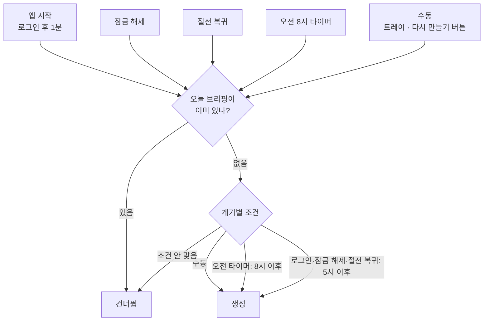
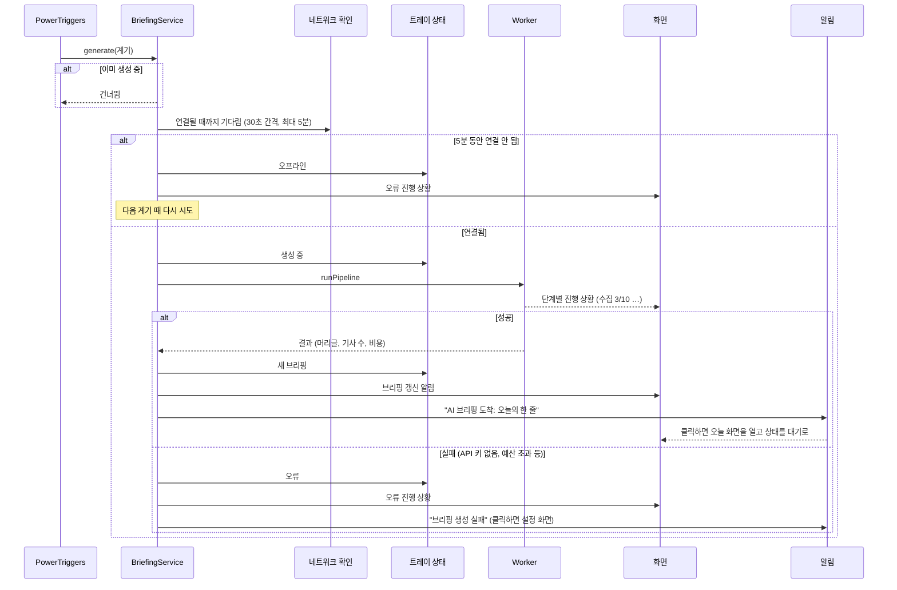
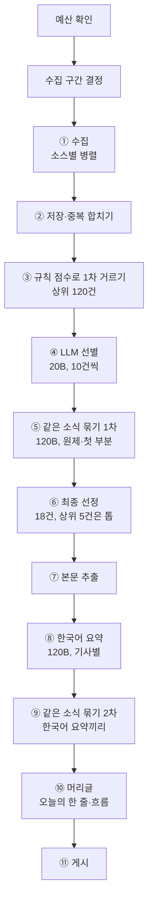
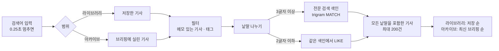
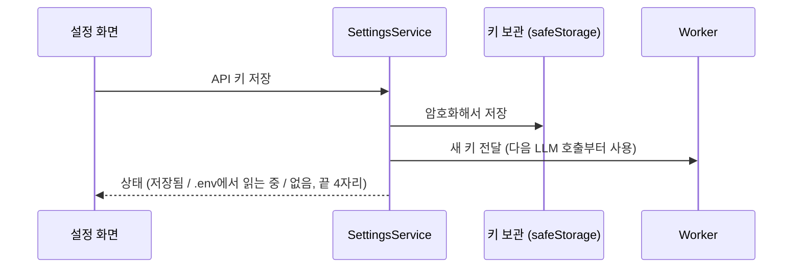

# 4. 주요 비즈니스 흐름

이 문서는 앱의 핵심 동작이 어떤 순서로, 어느 계층을 거쳐 일어나는지 설명합니다. 계층과 프로세스는 [2. 전체 아키텍처](02-architecture.md), 테이블은 [3. DB 구조](03-database.md)를 참고하세요.

---

## 4.1 브리핑을 언제 만드는가

브리핑은 하루에 한 번 만듭니다. "지금 만들어야 하나?"는 다섯 가지 계기에서 같은 규칙으로 판단합니다.

- **판단 규칙:** `src/shared/schedule.ts`의 `shouldGenerate` (순수 함수, 단위 테스트로 고정).
  - 8시 전에 로그인해도 5시 이후면 "일찍 출근"으로 보고 바로 만듭니다. 그러면 그날 8시 타이머는 오늘 브리핑이 이미 있어서 건너뜁니다.
  - 새벽 5시 전의 잠금 해제는 전날 밤 작업으로 보고 만들지 않습니다.
- **계기 감지:** `src/main/triggers/power-triggers.ts`의 `PowerTriggers`. Windows의 잠금 해제·절전 복귀 이벤트를 듣고, 다음 오전 8시까지 남은 시간만큼 타이머를 겁니다. 절전 중에는 타이머가 밀릴 수 있어서, 절전에서 깨어나면 타이머를 다시 계산합니다.
- **오늘 브리핑 여부:** Worker에 마지막 브리핑 날짜를 물어봅니다(`ContentService.getLastDigestDate` → DB `digests`).

---

## 4.2 브리핑 생성: Main 쪽 흐름

생성이 결정되면 Main의 `BriefingService.generate`(`src/main/services/briefing-service.ts`)가 전체 흐름을 이끕니다. 실제 수집·요약은 Worker가 하고, Main은 그 앞뒤(네트워크 확인, 상태 표시, 알림)를 맡습니다.

- 네트워크 확인은 단순한 온라인 여부가 아니라 Groq 서버까지 실제로 닿는지 봅니다(`platform/network.ts`). 로그인 직후 Wi-Fi·VPN이 늦게 붙는 경우를 위한 것입니다.
- 생성 중에 또 계기가 오면 두 번째 요청은 건너뜁니다. Worker 쪽에도 같은 보호가 있습니다(`WorkerService.runPipeline`).

---

## 4.3 브리핑 생성: Worker 파이프라인

Worker의 `runPipeline`(`src/worker/pipeline/run.ts`)이 수집부터 게시까지 한 번에 진행합니다. 단계마다 화면에 진행 상황을 보냅니다.

### 예산 확인
- 이번 달·오늘의 LLM 사용액을 `llm_usage`에서 합산합니다.
- 오늘 사용액이 **하루 상한**(기본 $0.5) 이상이면 생성을 중단합니다.
- 이번 달 사용액이 **월 예산**(기본 $5) 이상이면 **절약 모드**로 실행합니다. 요약·머리글도 작은 모델(20B)로 바꾸고, 브리핑 크기를 15건으로 줄입니다(`config.ts`의 `modelFor`).

### 수집 구간 결정
- "오늘 이전에 성공한 마지막 실행"의 시작 시각부터 지금까지를 모읍니다. 월요일에는 자연스럽게 주말 소식이 들어갑니다.
- 첫 실행이면 최근 24시간, 오래 비웠으면 최대 72시간까지만 모읍니다.
- 같은 날 다시 만들 때도 어제 실행을 기준으로 해서, 후보가 줄어들지 않게 합니다.
- 실행 기록은 `runs`에 남습니다.

### ① 수집
- `config/sources.yaml`의 켜진 소스마다 `collectSource`(`collectors/index.ts`)를 동시에 실행합니다. RSS·HF Papers·arXiv·Hacker News 수집기가 결과를 같은 형식으로 돌려줍니다.
- 소스 하나가 실패해도(타임아웃 15초) 나머지는 계속 진행하고, 실패한 소스는 브리핑 통계에 기록합니다.
- GeekNews는 관심 키워드에 맞는 글만, Hacker News는 키워드로 검색해 60점 이상만 가져옵니다.

### ② 저장·중복 합치기
- 수집한 글을 하나씩 `upsertRawItem`(`repo.ts`)으로 저장합니다.
- **같은 글 판정:** 정규화한 URL(`urlKey`: 추적 파라미터·www·끝의 / 제거, arXiv 주소 통일)이 같거나, 최근 3일 안에 정규화한 제목이 같으면 같은 글입니다.
- 같은 글이 다른 출처에서 또 들어오면 새로 만들지 않고, 그 출처를 `other_sources`에 붙이고 참여도는 큰 값을 남깁니다.

### ③ 규칙 점수로 1차 거르기
- 후보는 수집 구간 안에 들어왔고, 다른 기사에 합쳐지지 않았고, 오늘이 아닌 날의 브리핑에 실린 적이 없는 기사입니다(`getCandidates`).
- LLM 비용을 줄이려고 먼저 규칙으로 점수를 매깁니다(`select.ts`의 `ruleScore`). 소스 신뢰도, 관심 키워드(`config/interests.yaml`), 참여도, 다른 출처 수, 최신성을 더한 값입니다.
- 상위 120건만 다음 단계로 넘깁니다.

### ④ LLM 선별
- 아직 선별하지 않은 기사만 10건씩 묶어 20B 모델에 보냅니다. 제목과 첫 200자만 넘겨서 입력을 작게 유지합니다.
- 기사마다 분류(모델 출시 / 에이전트·툴링 / 논문 / 커뮤니티 / 업계·정책 / 그 외), 관련도(0~1), 중요도(1~5)를 받아 `items`에 저장합니다. 한 번 매긴 결과는 다시 쓰므로 같은 기사로 비용이 두 번 들지 않습니다.
- 모든 배치가 실패하면(키·네트워크 문제) 생성을 중단합니다. 일부만 실패하면 나머지로 진행합니다.

### ⑤ 같은 소식 묶기 (1차)
- 최종 점수 상위 후보(브리핑 크기의 두 배)를 120B 모델에 보내, 같은 발표를 다룬 기사끼리 묶게 합니다. 공식 발표·보도·커뮤니티 글처럼 출처나 언어가 달라도 같은 발표면 한 묶음입니다.
- 묶음마다 LLM이 **원본에 가장 가까운 기사**(공식 발표 > 보도 > 커뮤니티)를 대표로 고릅니다.
- 대표가 아닌 기사는 `merged_into`로 표시해 다음 후보에서 빠지고, 그 출처는 대표의 `other_sources`로 옮겨집니다(`applyClusters`, `mergeInto`). 대표는 묶인 기사들의 참여도·중요도 중 큰 값을 물려받습니다.

### ⑥ 최종 선정
- 최종 점수(`finalScore`)는 "중요도 × 관련도"를 중심으로 참여도·다른 출처 수·규칙 점수를 더한 값입니다.
- 관련도 0.4 미만은 빼되, 중요도 5짜리는 "그 외 주요 소식"으로 남깁니다.
- 분류별 상한(논문 5, 커뮤니티 4, 업계 4, 그 외 3)을 지키며 점수 순으로 브리핑 크기(기본 18건)까지 고릅니다. 상위 5건은 "오늘의 톱" 섹션, 나머지는 자기 분류 섹션에 들어갑니다(`selectEntries`).

### ⑦ 본문 추출
- 선정된 기사 중 본문이 아직 없는 것만 원문 페이지에서 본문을 추출합니다(`extractArticle`: Readability로 기사 영역을 찾고 문단으로 나눔).
- 논문은 HF·arXiv 초록을, 추출에 실패한 기사(403 등)는 RSS 요약을 본문 대신 씁니다. 어느 쪽인지 `contents.full_text`에 남깁니다.

### ⑧ 한국어 요약
- 아직 요약하지 않은 기사만 120B 모델로 한 건씩 요약합니다. 본문 앞부분(약 1,500토큰)만 입력합니다.
- 결과: 한국어 제목, 2~3문장 요약, 핵심 포인트, 왜 중요한가. 원제는 LLM이 만들지 않고 수집한 제목을 그대로 씁니다.
- 프롬프트(`config/prompts/summary.md`)는 원문에 없는 내용 쓰지 않기, 숫자·통화 단위 바꾸지 않기 같은 규칙을 둡니다.
- 요약에 실패한 기사는 원제와 RSS 요약으로 화면에 나옵니다.

### ⑨ 같은 소식 묶기 (2차)
- 선정된 기사들의 한국어 제목·요약끼리 다시 묶어 봅니다. 1차에서 언어가 달라 놓친 중복을 여기서 잡습니다.
- 빠진 자리는 다시 채우지 않고, 남은 기사로 순위와 섹션을 다시 매깁니다.

### ⑩ 머리글
- 선정된 기사들의 한국어 요약을 120B 모델에 보내 "오늘의 한 줄"(신문 1면 제목)과 2~3문장의 흐름 요약을 받습니다.
- 실패하면 1위 기사의 제목을 머리글로 씁니다.

### ⑪ 게시
- `publishDigest`가 그날 날짜의 `digests`·`digest_entries`를 씁니다. 같은 날짜가 이미 있으면(다시 만들기) 내용을 바꿔 끼웁니다.
- 실행 기록을 성공으로 닫고, 결과를 Main에 돌려줍니다. 어느 단계에서든 예외가 나면 실행 기록에 오류를 남기고 Main에 실패를 알립니다.

### LLM 호출 공통 처리
모든 LLM 호출은 한 실행 동안 `LlmSession`(`llm/service.ts`)을 거칩니다.
- 모델별 동시 호출을 4개로 제한합니다. 429(요청 제한)는 SDK가 기다렸다가 다시 시도합니다.
- 호출마다 토큰과 비용을 `llm_usage`에 기록합니다(단가는 `config/pricing.yaml`).
- 한 실행에서 100만 토큰을 넘으면 즉시 중단합니다(버그로 인한 비용 폭주 방지).
- 구조화 출력은 Groq의 strict JSON 스키마를 씁니다. gpt-oss가 배열을 객체로 감싸 보내는 실수를 하면, 응답에 실린 원문을 풀어서 살립니다(`completeJson`, `unwrapArrays`).
- 역할별 모델은 `config/models.yaml`에서만 바꿉니다.

---

## 4.4 읽기와 저장·메모

오늘·라이브러리·아카이브 화면은 같은 기사 패널(`ArticleDetail`)과 같은 동작을 씁니다.

- **저장은 기다리지 않습니다.** 저장 자체는 즉시 끝나고, 본문 추출과 태그 추천은 Worker가 뒤에서 합니다(`WorkerService.enrichLater` → `knowledge/enrich.ts`의 `enrichSavedItem`). 끝나면 성공·실패와 상관없이 화면에 알려서 "태그 추천 중" 표시가 남지 않게 합니다.
- **태그 추천:** 기존 태그 목록을 함께 보내서 같은 의미의 태그를 새로 만들지 않게 합니다. 사용자가 이미 태그를 붙였으면 추천하지 않습니다. 보강은 기사마다 한 번만 합니다(`saves.enriched_at`).
- **메모:** 입력을 멈추고 0.8초 뒤, 또는 입력란을 벗어나거나 다른 기사로 넘어갈 때 저장합니다(`MemoPad`). 메모를 쓰면 그 기사는 자동으로 저장되고 보강이 시작됩니다. 메모를 비우면 메모만 지우고 저장은 유지합니다.
- **태그 편집:** 직접 붙이거나 뗄 수 있습니다. 소문자·하이픈으로 정리하고, 하이픈만 다른 기존 태그가 있으면 그 표기를 씁니다. 아무 기사에도 안 쓰이게 된 태그는 지웁니다.
- **본문 탭:** 탭을 열면 기사 상세(`getItemDetail`)에서 문단 목록을 받아 ¶ 번호를 붙여 보여줍니다. 원문 추출에 실패한 기사는 그 사실을 표시합니다.

---

## 4.5 검색과 아카이브

- 화면의 `SearchInput`이 입력을 잠깐 멈췄을 때만 검색합니다. 요청은 Main의 `ContentService.search`를 거쳐 Worker의 `searchItems`로 갑니다.
- 검색 대상은 제목(원제·한국어), 요약·핵심 포인트·본문, 메모입니다. 색인은 기사 내용이 바뀔 때마다 그 기사만 다시 씁니다(3.4절).
- **아카이브 날짜별 보기:** 날짜 목록(`listDigests`: 날짜, 머리글, 기사 수, 그중 저장한 수)에서 하루를 고르면, 그날의 브리핑을 오늘 화면과 같은 지면(`DigestView`)으로 보여줍니다.

---

## 4.6 설정과 API 키

- **키 보관:** 설정에서 입력한 키는 Windows 계정 단위로 암호화해 `groq-key.bin`에 저장합니다(`platform/secrets.ts`). 개발 중에는 저장된 키가 없으면 프로젝트의 `.env`를 읽습니다.
- **키 변경 반영:** 키를 저장하거나 지우면 SettingsService가 Worker에 곧바로 알려서, 앱을 다시 켜지 않아도 다음 호출부터 새 키를 씁니다. 지우면 `.env` 키로 돌아갑니다.
- **예산:** 월 예산·하루 상한은 Worker의 `settings` 테이블에 저장되고, 다음 생성부터 4.3절의 예산 확인에 쓰입니다. 메뉴 하단과 설정 화면에 이번 달 사용액을 보여줍니다.
- **자동 시작:** Windows 로그인 항목에 등록합니다. 자동 시작으로 켜지면 창 없이 트레이에서 시작합니다.

---

## 4.7 실패와 복구

| 상황 | 동작 |
|---|---|
| 로그인 직후 네트워크 없음 | 30초 간격으로 최대 5분 기다림. 끝내 안 되면 트레이 "오프라인", 다음 잠금 해제·로그인 때 다시 시도 |
| API 키 없음·잘못됨 | 생성 실패 알림 → 클릭하면 설정 화면. 오늘 화면에도 오류와 "설정으로 이동" 표시 |
| 하루 상한 도달 | 그날은 새로 만들지 않음 (오류로 안내) |
| 월 예산 도달 | 절약 모드로 계속 생성 (작은 모델, 15건) |
| 소스 하나 실패 | 나머지로 진행, 실패한 소스는 통계에 기록 |
| LLM 선별 일부 실패 | 성공한 배치로 진행. 전부 실패하면 생성 중단 |
| 요약·묶기·머리글 실패 | 원제·RSS 요약 / 묶지 않고 / 1위 제목으로 대신해 진행 |
| 본문 추출 실패 | RSS 요약·초록으로 대신하고 "본문 없음" 표시 |
| Worker 비정상 종료 | Main이 3초 뒤 다시 띄움. 진행 중이던 요청은 실패로 돌려줌 |
| 앱이 생성 도중 꺼짐 | 다음 시작 때 `running`으로 남은 실행을 오류로 정리. 오늘 브리핑이 없으므로 다음 계기에 다시 생성 |

진단 화면(설정 → 진단)에서 트리거 기록, 알림 테스트, 네트워크 점검, 이벤트 기록을 볼 수 있습니다. 같은 기록이 `diagnostics.log`에도 남습니다.
