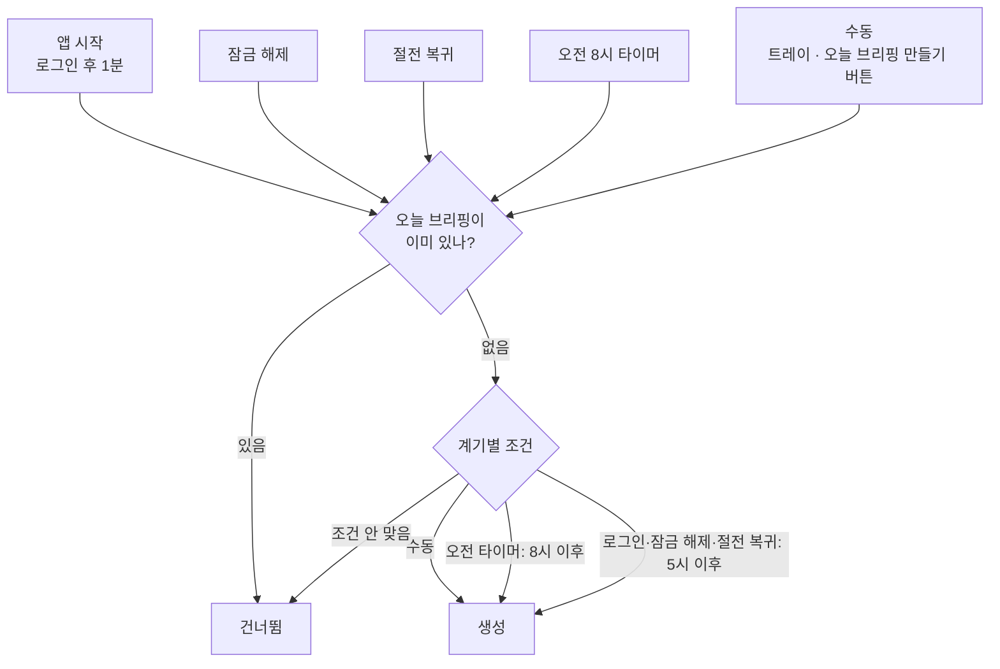
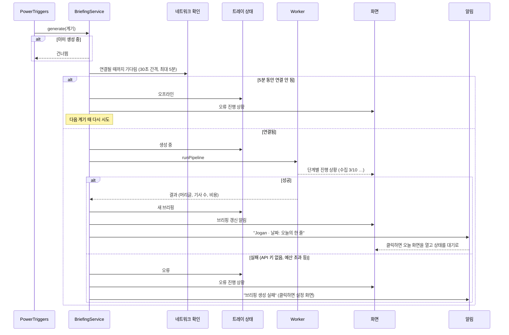
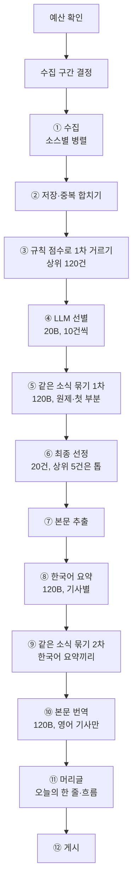
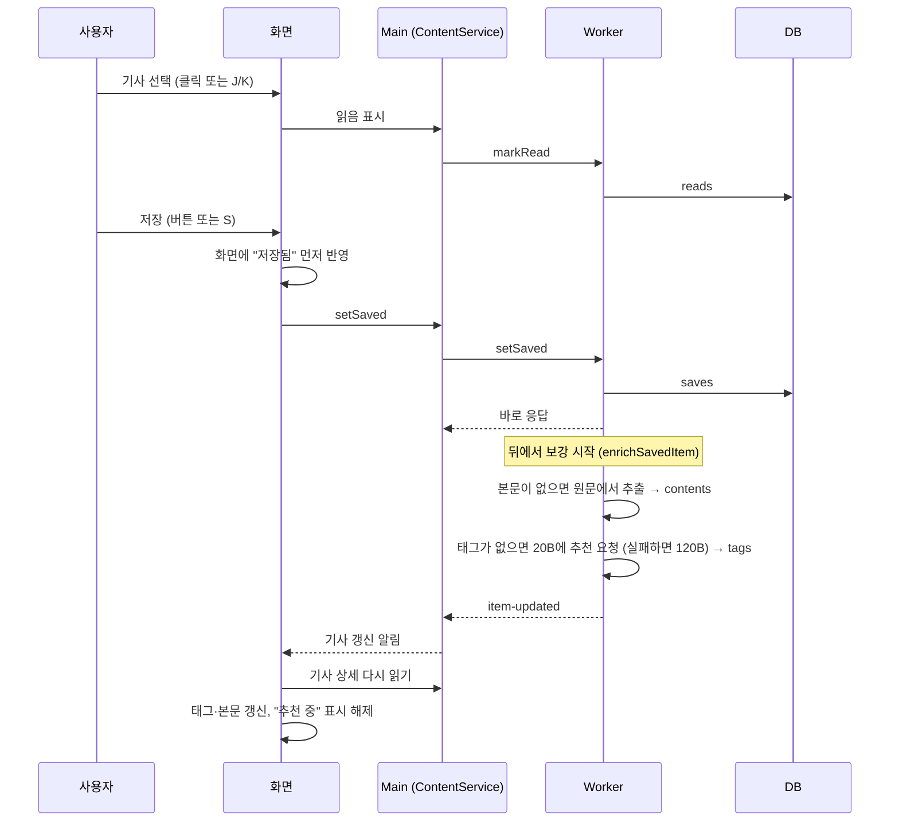
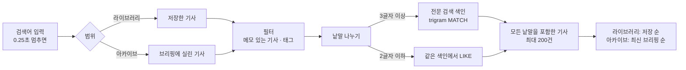
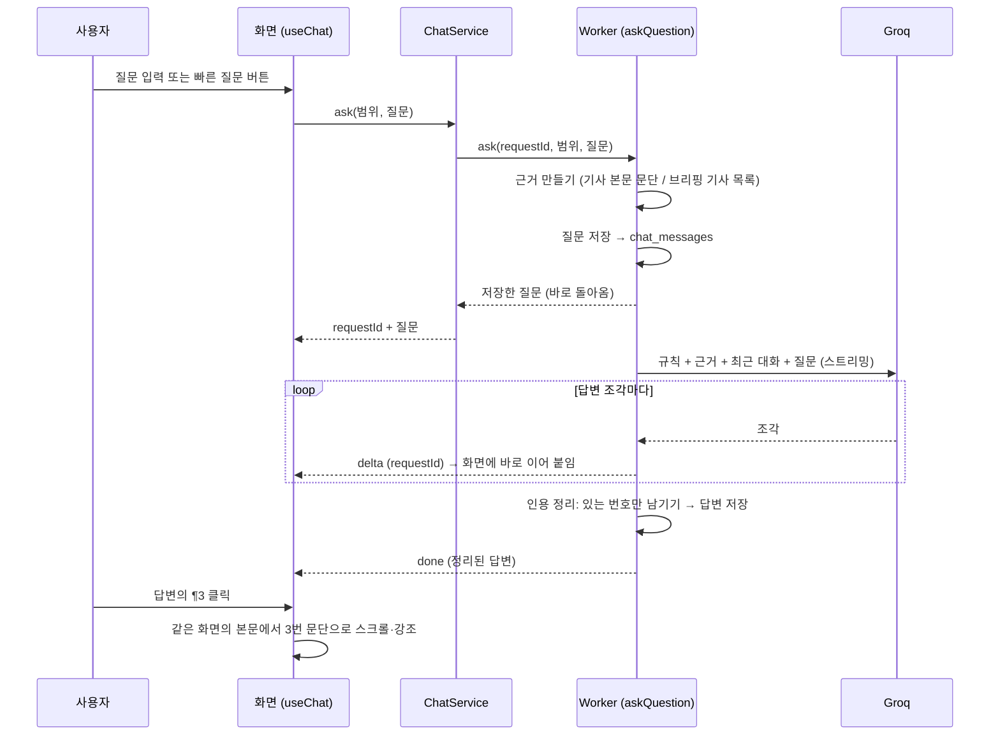
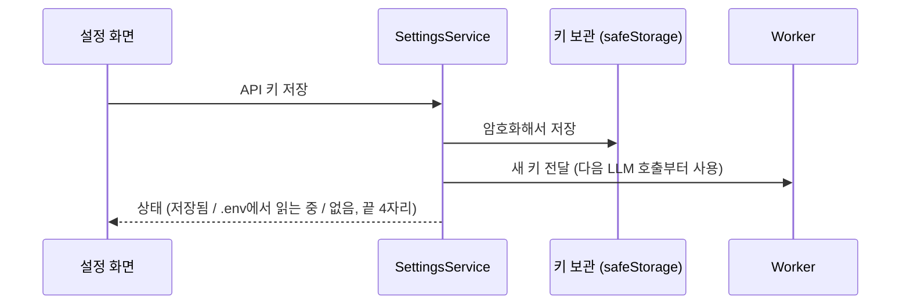

# 4. 주요 비즈니스 흐름

이 문서는 앱의 핵심 동작이 어떤 순서로, 어느 계층을 거쳐 일어나는지 설명합니다. 계층과 프로세스는 [2. 전체 아키텍처](02-architecture.md), 테이블은 [3. DB 구조](03-database.md)를 참고하세요.

---

## 4.1 브리핑을 언제 만드는가

브리핑은 하루에 한 번 만듭니다. "지금 만들어야 하나?"는 다섯 가지 계기에서 같은 규칙으로 판단합니다.

- **판단 규칙:** `src/shared/schedule.ts`의 `shouldGenerate` (순수 함수, 단위 테스트로 고정).
  - 8시 전에 로그인해도 5시 이후면 "일찍 출근"으로 보고 바로 만듭니다. 그러면 그날 8시 타이머는 오늘 브리핑이 이미 있어서 건너뜁니다.
  - 새벽 5시 전의 잠금 해제는 전날 밤 작업으로 보고 만들지 않습니다.
- **계기 감지:** `src/main/triggers/power-triggers.ts`의 `PowerTriggers`. Windows의 잠금 해제·절전 복귀 이벤트를 듣고, 다음 오전 8시까지 남은 시간만큼 타이머를 겁니다. 절전 중에는 타이머가 밀릴 수 있어서, 절전에서 깨어나면 타이머를 다시 계산합니다.
- **다시 만들기는 없습니다:** 오늘 브리핑이 있으면 수동 요청도 건너뜁니다. 같은 날 후보는 거의 같고 선별·요약 결과도 다시 쓰므로 결과가 비슷하고, 낮 동안 쌓인 새 글은 다음 날 브리핑에 들어가기 때문입니다. 화면의 "오늘 브리핑 만들기"는 오늘 것이 없거나 생성이 실패했을 때만 보입니다. 건너뛰면 `runNow`가 false를 돌려줘 화면이 "준비 중"에서 멈추지 않고, 트레이 메뉴는 창을 엽니다.
- **오늘 브리핑 여부:** Worker에 마지막 브리핑 날짜를 물어봅니다(`ContentService.getLastDigestDate` → DB `digests`).

### 낮 동안 미리 수집
- PC가 켜져 있는 동안 **2시간마다 수집만** 합니다(`triggers/collect-timer.ts`의 `CollectTimer` → `ContentService.collectOnly` → Worker `collectOnly`). LLM은 부르지 않으므로 비용이 들지 않습니다.
- 최근 24시간 글을 받아 쌓고, 중복은 DB에서 거릅니다(파이프라인 ①②와 같은 `collectAndStore`).
- 아침 브리핑은 "지난 실행 이후 쌓인 글"을 후보로 쓰므로, Reddit 인기글·GitHub 릴리스처럼 피드에서 금방 밀려나거나 아침 수집 구간보다 일찍 나온 글도 놓치지 않습니다.
- 절전 중에는 타이머가 밀리므로 10분마다 "마지막 수집 후 2시간이 지났나"를 확인합니다. 첫 수집은 앱 시작 2시간 뒤입니다. 오프라인이면 건너뛰고, 브리핑을 만드는 중이면 건너뜁니다.

---

## 4.2 브리핑 생성: Main 쪽 흐름

생성이 결정되면 Main의 `BriefingService.generate`(`src/main/services/briefing-service.ts`)가 전체 흐름을 이끕니다. 실제 수집·요약은 Worker가 하고, Main은 그 앞뒤(네트워크 확인, 상태 표시, 알림)를 맡습니다.

- 네트워크 확인은 단순한 온라인 여부가 아니라 Groq 서버까지 실제로 닿는지 봅니다(`platform/network.ts`). 로그인 직후 Wi-Fi·VPN이 늦게 붙는 경우를 위한 것입니다.
- 생성 중에 또 계기가 오면 두 번째 요청은 건너뜁니다. Worker 쪽에도 같은 보호가 있습니다(`WorkerService.runPipeline`).

---

## 4.3 브리핑 생성: Worker 파이프라인

Worker의 `runPipeline`(`src/worker/pipeline/run.ts`)이 수집부터 게시까지 한 번에 진행합니다. 단계마다 화면에 진행 상황을 보냅니다.

### 예산 확인
- 이번 달·오늘의 LLM 사용액을 `llm_usage`에서 합산합니다.
- 오늘 사용액이 **하루 상한**(기본 $0.5) 이상이면 생성을 중단합니다.
- 이번 달 사용액이 **월 예산**(기본 $5) 이상이면 **절약 모드**로 실행합니다. 요약·머리글도 작은 모델(20B)로 바꾸고, 브리핑 크기를 15건으로 줄이고, 본문 번역은 미리 하지 않고 기사를 열 때 합니다(`config.ts`의 `modelFor`).

### 수집 구간 결정
- "오늘 이전에 성공한 마지막 실행"의 시작 시각부터 지금까지를 모읍니다. 월요일에는 자연스럽게 주말 소식이 들어갑니다.
- 첫 실행이면 최근 24시간, 오래 비웠으면 최대 72시간까지만 모읍니다.
- 같은 날 다시 만들 때도 어제 실행을 기준으로 해서, 후보가 줄어들지 않게 합니다.
- 실행 기록은 `runs`에 남습니다.

### ① 수집
- `config/sources.yaml`의 켜진 소스마다 `collectSource`(`collectors/index.ts`)를 동시에 실행합니다. RSS·HF Papers·arXiv·Hacker News·GitHub 릴리스 수집기가 결과를 같은 형식으로 돌려줍니다.
- 소스 하나가 실패해도(타임아웃 15초) 나머지는 계속 진행하고, 실패한 소스는 브리핑 통계에 기록합니다.
- GeekNews·국내 기술블로그처럼 `keywordFilter`가 켜진 피드는 관심 키워드에 맞는 글만, Hacker News는 키워드로 검색해 60점 이상, Show HN은 30점 이상만 가져옵니다. Reddit r/LocalLLaMA는 하루 인기글 피드의 앞 15개만 받습니다(`maxItems`).
- **GitHub 릴리스:** 감시 목록의 저장소마다 `releases.atom`을 읽어 메이저·마이너 버전(x.y, x.y.0)만 받습니다. 패치 버전과 rc·beta·dev 같은 프리릴리스는 버립니다(`releaseVersion`). 한 저장소에서 여러 패키지를 내면(`langchain-ai/langgraph`) `match`로 패키지를 고릅니다. 릴리스 노트가 곧 본문입니다.

### ② 저장·중복 합치기
- 수집한 글을 하나씩 `upsertRawItem`(`repo.ts`)으로 저장합니다.
- **같은 글 판정:** 정규화한 URL(`urlKey`: 추적 파라미터·www·끝의 / 제거, arXiv 주소 통일)이 같거나, 최근 3일 안에 정규화한 제목이 같으면 같은 글입니다.
- 같은 글이 다른 출처에서 또 들어오면 새로 만들지 않고, 그 출처를 `other_sources`에 붙이고 참여도는 큰 값을 남깁니다.

### ③ 규칙 점수로 1차 거르기
- 후보는 수집 구간 안에 들어왔고, 다른 기사에 합쳐지지 않았고, 오늘이 아닌 날의 브리핑에 실린 적이 없는 기사입니다(`getCandidates`).
- LLM 비용을 줄이려고 먼저 규칙으로 점수를 매깁니다(`select.ts`의 `ruleScore`). 소스 신뢰도, 관심 키워드(`config/interests.yaml`), 참여도, 다른 출처 수, 최신성을 더한 값입니다.
- 상위 120건만 다음 단계로 넘깁니다.

### ④ LLM 선별
- 아직 선별하지 않은 기사만 10건씩 묶어 20B 모델에 보냅니다. 제목과 첫 200자만 넘겨서 입력을 작게 유지합니다.
- 기사마다 분류(모델 출시 / 도구·라이브러리 / 실전·응용 / 논문 / 커뮤니티 / 업계·정책 / 그 외), 관련도(0~1), 중요도(1~5)를 받아 `items`에 저장합니다. 프롬프트는 독자를 "AI로 제품을 만드는 개발자"로 두고, 바로 써볼 도구와 수치가 담긴 구현 경험을 높게, 홍보성 글과 패치 수준 업데이트를 낮게 매기게 합니다. 한 번 매긴 결과는 다시 쓰므로 같은 기사로 비용이 두 번 들지 않습니다.
- 모든 배치가 실패하면(키·네트워크 문제) 생성을 중단합니다. 일부만 실패하면 나머지로 진행합니다.

### ⑤ 같은 소식 묶기 (1차)
- 최종 점수 상위 후보(브리핑 크기의 두 배)를 120B 모델에 보내, 같은 발표를 다룬 기사끼리 묶게 합니다. 공식 발표·보도·커뮤니티 글처럼 출처나 언어가 달라도 같은 발표면 한 묶음입니다.
- 묶음마다 LLM이 **원본에 가장 가까운 기사**(공식 발표 > 보도 > 커뮤니티)를 대표로 고릅니다.
- 대표가 아닌 기사는 `merged_into`로 표시해 다음 후보에서 빠지고, 그 출처는 대표의 `other_sources`로 옮겨집니다(`applyClusters`, `mergeInto`). 대표는 묶인 기사들의 참여도·중요도 중 큰 값을 물려받습니다.

### 지난 7일 중복 확인
- 1차로 묶은 상위 후보를 지난 7일 브리핑에 실린 기사 목록(오늘 브리핑 제외, `recentPublished`)과 함께 120B에 보내, 이미 보낸 소식인지 가립니다(`config/prompts/recent.md`). 출처·언어가 달라도 같은 발표면 같은 소식입니다.
- **이미 보낸 소식:** 후보에서 빼고, 지난 기사에 출처로 붙입니다(`mergeInto`). 빠진 자리는 다음 후보로 채웁니다.
- **후속 소식:** 같은 소식이지만 중요한 새 전개(발표 → 실제 출시, 새 수치·가격, 정책 확정, 판결 등)면 싣되 `follow_up_of`에 지난 기사를 표시합니다. 목록에 "후속" 배지, 읽기 화면에 "지난 10/7(수) 브리핑에 실린 …의 새 전개" 안내가 나옵니다.
- 실패하면 확인 없이 진행합니다. 호출 한 번, 약 $0.001입니다.

### ⑥ 최종 선정
- 최종 점수(`finalScore`)는 "중요도 × 관련도"를 중심으로 참여도·다른 출처 수·규칙 점수를 더한 값입니다.
- 관련도 0.4 미만은 빼되, 중요도 5짜리는 "그 외 주요 소식"으로 남깁니다.
- **최소 몫:** 도구·라이브러리 3건, 실전·응용 2건을 먼저 채웁니다. 큰 뉴스에 밀려 개발자에게 쓸모 있는 소식이 빠지지 않게 하려는 것입니다. 단, 관련도 0.6·중요도 2 이상인 후보만 몫으로 넣습니다(자리 채우기용 약한 글 방지).
- 나머지 자리는 분류별 상한(논문 3, 커뮤니티 4, 업계 3, 그 외 3)을 지키며 점수 순으로 브리핑 크기(기본 20건)까지 채웁니다. 순위는 몫으로 들어온 기사도 점수대로 매기고, 상위 5건은 "오늘의 톱" 섹션, 나머지는 자기 분류 섹션에 들어갑니다(`selectEntries`).

### ⑦ 본문 추출
- 선정된 기사 중 본문이 아직 없는 것만 원문 페이지에서 본문을 추출합니다(`content.ts`의 `ensureContent` → `extractArticle`: Readability로 기사 영역을 찾고 문단으로 나눔).
- 논문은 HF·arXiv 초록을, 릴리스는 릴리스 노트를, HN·Reddit 토론 페이지와 추출에 실패한 기사(403 등)는 수집한 요약을 본문 대신 씁니다. 어느 쪽인지 `contents.full_text`에 남깁니다.
- **본문이 없는 기사는 싣지 않습니다:** 본문이 300자 미만(제목·한 줄 소개뿐)이면 제목만으로 요약하다 내용을 지어내게 되므로 빼고, 다음 순위 후보로 채웁니다(`select.ts`의 `fillWithContent`). 채울 때도 분류별 최소 몫·상한을 지키고, 추출 시도는 브리핑 크기의 2배까지만 합니다. 빠진 기사는 요약하지 않아 비용이 들지 않습니다. 저장한 기사에는 이 규칙을 쓰지 않습니다.

### ⑧ 한국어 요약
- 아직 요약하지 않은 기사만 120B 모델로 한 건씩 요약합니다. 본문은 최대 12,000자(약 3,000토큰)까지 넣어서, 보통 기사는 전부 읽고 요약합니다.
- 결과: 한국어 제목, 2~3문장 요약, 핵심 포인트 3~5개(수치·버전·사용 방법·한계처럼 판단에 쓰는 내용 우선), 왜 중요한가. 본문 전체 번역이 따로 있으므로 긴 상세 요약은 만들지 않습니다. 원제는 LLM이 만들지 않고 수집한 제목을 그대로 씁니다.
- 프롬프트(`config/prompts/summary.md`)는 원문에 없는 내용 쓰지 않기, 숫자·통화 단위 바꾸지 않기 같은 규칙을 둡니다.
- 요약에 실패한 기사는 원제와 RSS 요약으로 화면에 나옵니다.

### ⑨ 같은 소식 묶기 (2차)
- 선정된 기사들의 한국어 제목·요약끼리 다시 묶어 봅니다. 1차에서 언어가 달라 놓친 중복을 여기서 잡습니다.
- 빠진 자리는 다시 채우지 않고, 남은 기사로 순위와 섹션을 다시 매깁니다.

### ⑩ 본문 번역
- 선정된 기사 중 영어 기사의 본문을 문단 단위로 한국어로 옮깁니다(`knowledge/translate.ts`의 `translateItem`). 문단 번호가 원문과 같아서 AI 답변의 [¶n] 인용과 강조가 번역·원문 어느 쪽에서도 맞습니다.
- **번역하지 않는 기사:** 한국어 기사(소스 언어가 `ko`이거나 제목·첫 부분이 대부분 한글, `needsTranslation`). 논문은 본문이 초록이라 초록만 번역됩니다.
- **나눠 보내기:** 원문 약 5,000자씩 묶어 120B에 보내고, 묶음은 동시에 처리합니다. 응답은 `{n, ko}` 목록이라 문단을 합치거나 빠뜨려도 번호로 제자리를 찾습니다. 구조화 출력이 깨지면 한 번 더 시도합니다.
- **상한:** 기사 한 건에 원문 **40,000자**까지 번역합니다(보통 기사 3~6천 자의 10배 가까이). 아주 긴 기사의 나머지 문단은 `null`로 두고 화면에서 원문으로 보여줍니다. 최악의 경우에도 기사 한 건 약 $0.01입니다.
- 번역에 실패한 기사는 번역 없이 게시하고, 나중에 읽기 화면을 열 때 다시 시도합니다.
- 프롬프트(`config/prompts/translate.md`)는 요약하지 않고 전부 옮기기, 코드·이름·URL은 그대로 두기, 숫자·통화 단위 규칙을 둡니다.

### ⑪ 머리글
- 선정된 기사들의 한국어 요약을 120B 모델에 보내 "오늘의 한 줄"(신문 1면 제목)과 2~3문장의 흐름 요약을 받습니다.
- 실패하면 1위 기사의 제목을 머리글로 씁니다.

### ⑫ 게시
- `publishDigest`가 그날 날짜의 `digests`·`digest_entries`를 씁니다. 같은 날짜가 이미 있으면 내용을 바꿔 끼웁니다(보통은 생기지 않음).
- 실행 기록을 성공으로 닫고, 결과를 Main에 돌려줍니다. 어느 단계에서든 예외가 나면 실행 기록에 오류를 남기고 Main에 실패를 알립니다.

### LLM 호출 공통 처리
모든 LLM 호출은 한 실행 동안 `LlmSession`(`llm/service.ts`)을 거칩니다.
- 모델별 동시 호출을 4개로 제한합니다. 429(요청 제한)는 SDK가 기다렸다가 다시 시도합니다.
- 호출마다 토큰과 비용을 `llm_usage`에 기록합니다(단가는 `config/pricing.yaml`).
- 한 실행에서 100만 토큰을 넘으면 즉시 중단합니다(버그로 인한 비용 폭주 방지).
- 구조화 출력은 Groq의 strict JSON 스키마를 씁니다. gpt-oss가 배열을 객체로 감싸 보내는 실수를 하면, 응답에 실린 원문을 풀어서 살립니다(`completeJson`, `unwrapArrays`).
- 역할별 모델은 `config/models.yaml`에서만 바꿉니다.

---

## 4.4 읽기와 저장·메모

오늘·라이브러리·아카이브 화면은 같은 구성입니다. 목록에서 기사를 고르면 옆 패널에 개요(`ArticlePreview`)가 나오고, 목록 줄 오른쪽의 "읽기 →"(선택한 줄에 늘 보이고 다른 줄은 마우스를 올리면 보임, `RowReadButton`)나 Enter·두 번 클릭으로 기사 읽기 화면(`ArticleReader`)으로 바뀝니다. 읽기 화면은 넓은 본문 단과 메모·질문·하이라이트 단으로 되어 있고, J/K로 다음·이전 기사, Esc로 목록에 돌아갑니다. 옆 단은 탭(고정)과 내용(따로 스크롤)으로 나뉩니다.

**너비 조절:** 목록 화면의 오른쪽 기사 패널과 읽기 화면의 메모·질문 단은 왼쪽 경계선을 끌어 너비를 바꿉니다(`ResizeHandle`). 320~720px이되 창 너비의 절반을 넘지 않고, 두 번 누르면 기본 너비(패널 460px, 읽기 화면 440px)로 돌아갑니다. 마지막 너비는 이 PC에 기억하고, 오늘·라이브러리·검색 결과는 같은 너비를 씁니다.

아카이브는 옆 패널 없이 날짜 목록을 화면 폭 전체로 보여주고, J/K로 고르고 Enter나 "보기 →"로 그날 지면을 엽니다.

- **저장은 기다리지 않습니다.** 저장 자체는 즉시 끝나고, 본문 추출과 태그 추천은 Worker가 뒤에서 합니다(`WorkerService.enrichLater` → `knowledge/enrich.ts`의 `enrichSavedItem`). 끝나면 성공·실패와 상관없이 화면에 알려서 "태그 추천 중" 표시가 남지 않게 합니다.
- **태그 추천:** 기존 태그 목록을 함께 보내서 같은 의미의 태그를 새로 만들지 않게 합니다. 사용자가 이미 태그를 붙였으면 추천하지 않습니다. 보강은 기사마다 한 번만 합니다(`saves.enriched_at`).
- **메모:** 입력을 멈추고 0.8초 뒤, 또는 입력란을 벗어나거나 다른 기사로 넘어갈 때 저장합니다(`MemoPad`). 메모를 쓰면 그 기사는 자동으로 저장되고 보강이 시작됩니다. 메모를 비우면 메모만 지우고 저장은 유지합니다.
- **태그 편집:** 직접 붙이거나 뗄 수 있습니다. 소문자·하이픈으로 정리하고, 하이픈만 다른 기존 태그가 있으면 그 표기를 씁니다. 아무 기사에도 안 쓰이게 된 태그는 지웁니다.
- **본문:** 읽기 화면은 기사 상세(`getItemDetail`)에서 문단 목록과 문단별 번역을 받아 ¶ 번호를 붙여 보여줍니다. 원문 추출에 실패한 기사는 그 사실을 표시합니다.
- **본문 보기 전환:** 번역이 있으면 본문 제목 옆에 [한국어 | 원문 | 함께 보기] 전환기가 나옵니다(T 키로 차례로 바꿈). 함께 보기는 번역 문단 아래에 원문을 작게 붙입니다. 마지막에 고른 방식은 이 PC에 기억합니다(`useBodyMode`). 번역하지 않은 문단은 원문으로 보여주고 그 개수를 알립니다.
- **열 때 번역:** 번역이 아직 없는 영어 기사(절약 모드였거나, 브리핑 밖에서 저장했거나, 번역이 실패한 기사)를 열면 화면이 번역을 요청합니다(`useAutoTranslate` → `translateItem`). 그동안 원문을 보여주며 "옮기는 중"을 알리고, 끝나면 item-updated로 그 자리에서 번역으로 바뀝니다. 기사마다 한 번만 자동 요청하고, 실패하면 "다시 시도" 버튼을 보여줍니다. 하루 사용 상한에 닿았으면 번역하지 않습니다.
- **저장할 때:** 저장 후 보강으로 본문을 새로 뽑으면 번역도 새로 만듭니다(절약 모드가 아니면).

### 하이라이트
- **긋기:** 본문 문장을 드래그하면 선택 영역 위에 작은 막대(하이라이트 / 질문)가 뜹니다(`SelectionToolbar`). "하이라이트" 또는 `H`를 누르면 선택 영역을 문단별 위치로 바꿔(`lib/highlight.ts`의 `rangesFromSelection`) 저장합니다. 여러 문단에 걸치면 문단마다 하나씩 생깁니다.
- **번역문과 원문:** 문단마다 `data-para`(¶ 번호)와 `data-variant`(ko / original)가 붙어 있어 어느 판에 그었는지 함께 저장합니다.
- **보이는 모양:** 형광펜처럼 글자 아래쪽만, 끝이 둥글고 기울게, 가운데가 짙게 칠합니다(app.css의 `.marker`). 메모를 붙인 하이라이트는 끝에 ✎ 표시가 붙습니다. 하이라이트가 있는 문단은 ¶ 옆 여백에 강조색 괘선이 그어지고, 지금 보이지 않는 판(번역문/원문)에만 있으면 괘선이 옅습니다.
- **메모 카드:** 본문의 하이라이트에 마우스를 올리면 작은 카드(`HighlightCard`)가 떠서 메모 보기·고치기, 이 부분 질문, 지우기를 바로 할 수 있습니다. 스크롤하거나 하이라이트와 카드 밖으로 나가면 닫힙니다.
- **저장:** Worker가 보관된 본문에서 그 구간의 글자를 잘라 저장하고, 같은 문단·같은 판에서 겹치면 합칩니다(`repo.addHighlights`). 처음 하이라이트한 기사는 자동으로 저장되고 저장 후 보강이 시작됩니다.
- **하이라이트 탭:** 읽기 화면 옆 단의 "하이라이트 N" 탭에 본문 순서대로 모입니다(`HighlightList`). 인용문을 누르면 본문의 그 문단으로 가고, 하이라이트마다 메모를 붙일 수 있고(입력란을 벗어나면 저장), "이 부분 질문"을 누르면 질문 탭 입력란에 그 문장을 인용한 질문 초안이 채워집니다. 본문의 하이라이트를 누르면 탭에서 그 항목을 보여줍니다.
- **위치가 어긋날 때:** 본문을 다시 뽑거나 다시 번역하면 위치가 바뀔 수 있어, 저장된 위치의 글자가 다르면 그은 글자를 찾아 옮겨 칠합니다. 못 찾으면 탭 목록에만 남습니다.
- 하이라이트 글자와 메모는 검색 색인에 들어가서 라이브러리 검색으로 찾을 수 있습니다.

---

## 4.5 검색과 아카이브

- 화면의 `SearchInput`이 입력을 잠깐 멈췄을 때만 검색합니다. 요청은 Main의 `ContentService.search`를 거쳐 Worker의 `searchItems`로 갑니다.
- 검색 대상은 제목(원제·한국어), 요약·핵심 포인트·본문, 메모입니다. 색인은 기사 내용이 바뀔 때마다 그 기사만 다시 씁니다(3.4절).
- **아카이브 날짜별 보기:** 날짜 목록(`listDigests`: 날짜, 머리글, 기사 수, 그중 저장한 수)에서 하루를 고르면, 그날의 브리핑을 오늘 화면과 같은 지면(`DigestView`)으로 보여줍니다.

---

## 4.6 AI 질문

기사 읽기 화면의 "질문" 단(또는 `/` 키)에서 기사 한 건에, 메뉴의 "질문" 화면에서 그날 브리핑 전체에 질문합니다.

- **근거 만들기** (`knowledge/chat.ts`)
  - 기사 채팅: 보관된 본문 문단마다 `[¶번호]`를 붙여 넘깁니다. 본문이 길면(약 12,000토큰 초과) 앞 3문단과 질문과 낱말이 많이 겹치는 문단만 고르고, 번호는 원래 번호를 유지합니다(`citations.ts`의 `selectParagraphs`). 저장하지 않은 기사는 브리핑 때 보관한 본문·요약을 씁니다.
  - 브리핑 채팅: 그날 실린 기사마다 `[#순위]`와 한국어 제목·분류·출처·요약·왜 중요한가를 넘깁니다.
- **프롬프트 규칙** (`config/prompts/chat-item.md`, `chat-digest.md`): 근거에서 가져온 문장 끝에 번호를 붙이기, 근거에 없는 것은 "기사에는 그 내용이 없습니다"라고 먼저 밝히고 일반 지식과 구분하기, 수치·통화 표기 그대로, 마크다운 쓰지 않기.
- **인용 정리** (`cleanCitations`): 답변이 끝나면 근거에 실제로 있는 번호만 남기고, 모델이 지어낸 번호는 지웁니다. 남은 번호 목록을 함께 저장합니다.
- **대화 이어가기:** 최근 10턴(질문·답 20개)을 함께 보냅니다. 규칙과 근거를 맨 앞에 두므로 같은 기사로 이어서 물으면 Groq 자동 캐싱으로 그 부분의 입력 비용이 절반이 됩니다.
- **모델과 비용:** `config/models.yaml`의 `chat` 역할(120B, 추론 low, 출력 최대 2,000토큰). 월 예산에 도달하면 절약 모드 모델(20B)로 답합니다. 하루 상한은 브리핑 생성만 막고 질문은 막지 않습니다. 호출마다 `llm_usage`에 `chat`으로 기록합니다.
- **답변 조각의 전달:** Worker의 답변 조각은 Main을 거쳐 열려 있는 창으로 방송되고, 화면(`useChat`)은 자기 질문의 requestId인 조각만 받습니다. 질문 응답보다 조각이 먼저 도착해도 잠시 모아 두었다가 이어 붙입니다.
- **빠른 질문:** `config/quick-actions.yaml`의 버튼(기사: 쉽게 설명·기술 디테일·내 일에 적용하면?·한계와 반론 / 브리핑: 꼭 읽을 3개·오늘의 흐름·바로 써볼 것). 버튼을 누르면 그 문장을 질문으로 보냅니다.
- **메모에 추가:** 답변 아래 버튼으로 그 답변을 기사 메모 끝에 덧붙입니다. 메모를 쓴 것과 같으므로 기사가 자동 저장되고 보강이 시작됩니다(4.4절).
- **브리핑 채팅의 인용:** `#3`을 누르면 오늘 화면으로 가서 그 기사를 선택합니다(분류 필터는 풀림). 마우스를 올리면 기사 제목이 보입니다.
- **대화 지우기:** 그 범위의 대화만 지웁니다.

---

## 4.7 설정과 API 키

- **키 보관:** 설정에서 입력한 키는 Windows 계정 단위로 암호화해 `groq-key.bin`에 저장합니다(`platform/secrets.ts`). 개발 중에는 저장된 키가 없으면 프로젝트의 `.env`를 읽습니다.
- **키 변경 반영:** 키를 저장하거나 지우면 SettingsService가 Worker에 곧바로 알려서, 앱을 다시 켜지 않아도 다음 호출부터 새 키를 씁니다. 지우면 `.env` 키로 돌아갑니다.
- **예산:** 월 예산·하루 상한은 Worker의 `settings` 테이블에 저장되고, 다음 생성부터 4.3절의 예산 확인에 쓰입니다. 메뉴 하단과 설정 화면에 이번 달 사용액을 보여줍니다.
- **자동 시작:** Windows 로그인 항목에 등록합니다. 자동 시작으로 켜지면 창 없이 트레이에서 시작합니다.

---

## 4.8 실패와 복구

| 상황 | 동작 |
|---|---|
| 로그인 직후 네트워크 없음 | 30초 간격으로 최대 5분 기다림. 끝내 안 되면 트레이 "오프라인", 다음 잠금 해제·로그인 때 다시 시도 |
| API 키 없음·잘못됨 | 생성 실패 알림 → 클릭하면 설정 화면. 오늘 화면에도 오류와 "설정으로 이동" 표시 |
| 하루 상한 도달 | 그날은 새로 만들지 않음 (오류로 안내) |
| 월 예산 도달 | 절약 모드로 계속 생성 (작은 모델, 15건) |
| 소스 하나 실패 | 나머지로 진행, 실패한 소스는 통계에 기록 |
| LLM 선별 일부 실패 | 성공한 배치로 진행. 전부 실패하면 생성 중단 |
| 요약·묶기·머리글 실패 | 원제·RSS 요약 / 묶지 않고 / 1위 제목으로 대신해 진행 |
| 본문 추출 실패 | RSS 요약·초록으로 대신하고 "본문 없음" 표시 |
| 질문 답변 실패 (네트워크·키) | 화면에 오류 표시. 질문은 대화에 남고 다시 물을 수 있음 |
| Worker 비정상 종료 | Main이 3초 뒤 다시 띄움. 진행 중이던 요청은 실패로 돌려줌 |
| 앱이 생성 도중 꺼짐 | 다음 시작 때 `running`으로 남은 실행을 오류로 정리. 오늘 브리핑이 없으므로 다음 계기에 다시 생성 |

진단 화면(설정 → 진단)에서 트리거 기록, 알림 테스트, 네트워크 점검, 이벤트 기록을 볼 수 있습니다. 같은 기록이 `diagnostics.log`에도 남습니다.
