# Jogan 문서

Jogan(조간)의 개요, 구조, DB, 주요 동작을 한 문서에 정리했습니다. 설계 과정과 결정 기록은 루트의 [DESIGN.md](../DESIGN.md)에 있습니다.

1. [개요](#1-개요)
2. [아키텍처](#2-아키텍처)
3. [DB 구조](#3-db-구조)
4. [주요 흐름](#4-주요-흐름)

---

## 1. 개요

### 1.1 무엇을 하는 프로그램인가

**Jogan(조간)** 은 LLM·AI 에이전트 분야의 소식을 매일 자동으로 모아 한국어로 요약·번역해 주는 Windows 상주형 데스크톱 앱입니다.

출근해서 PC를 켜면 트레이에 상주하던 앱이 그날의 브리핑을 만들고 알림을 띄웁니다. 알림을 누르면 신문 지면처럼 정리된 "오늘" 화면이 열립니다. 쓸만한 기사는 저장·메모·하이라이트해서 **개인 AI 지식 저장소**로 쌓고, 기사나 브리핑을 근거로 AI에게 질문할 수 있습니다.

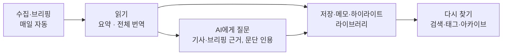

### 1.2 주요 기능

| 기능 | 설명 |
|---|---|
| 매일 브리핑 | 수집 → 중복 합치기 → AI 선별 → 같은 소식 묶기 → 지난 7일 중복 제외 → 선정(본문 없는 기사 제외) → 한국어 요약 → 영어 기사 본문 전체 번역. 하루 20건, 1회 약 $0.01~0.02 |
| 자동 실행 | 로그인·잠금 해제(5시 이후) 또는 켜둔 채 오전 8시에 하루 한 번. 네트워크가 늦게 붙으면 최대 5분 기다림. 켜져 있는 동안 2시간마다 수집만 미리 해 둠(LLM 비용 없음) |
| 7일 중복 방지 | 지난 7일 브리핑에 실린 소식은 다시 싣지 않음. 중요한 새 전개면 "후속" 표시를 달아 실음 |
| 오늘 화면 | 오늘의 한 줄, 분류 탭, 섹션별 목록, 옆 패널 개요, 기사 읽기 화면(요약·핵심 포인트 3~5개·본문을 한국어 / 원문 / 함께 보기로) |
| 저장·메모 | 저장하면 원문 본문을 문단 단위로 보관하고 AI가 태그를 추천. 줄 노트 메모는 자동 저장 |
| 하이라이트 | 본문 문장을 드래그해 형광펜(H). 번역문·원문 어디에나 긋고, 메모 카드·"이 부분 질문". 그은 기사는 자동 저장 |
| 라이브러리 | 저장한 기사를 제목·요약·본문·번역·메모·하이라이트로 검색, 메모 있는 기사·태그로 필터 |
| 아카이브 | 날짜별 지난 브리핑을 그날 지면 그대로 보기, 지금까지 실린 모든 기사 검색 |
| AI 질문 | 기사 본문을 근거로 묻고 답함(답변의 ¶번호를 누르면 그 문단으로). 오늘 브리핑 전체에도 질문(#번호를 누르면 그 기사로). 빠른 질문, 답변을 메모로 옮기기 |
| 출처 통계 | 어디서 자료를 받는지, 얼마나 받아서 얼마나 브리핑에 실리는지(수집 → 중복 합침 → AI 선별 → 실림 → 저장), 날마다 추이, 출처별 상태·수집 기록. 7일·30일·전체와 전체 누적 |
| 비용 관리 | 월 예산(기본 $5)·하루 상한($0.5)·실행당 토큰 상한. 예산 도달 시 작은 모델로 바꾸는 절약 모드 |

### 1.3 수집 소스

`config/sources.yaml`에서 켜고 끕니다.

| 분류 | 소스 |
|---|---|
| 랩 공식 블로그 | OpenAI, Google DeepMind, Google AI, Hugging Face (Anthropic은 RSS가 없어 꺼둠) |
| LLM 전문 블로그 | Simon Willison, Latent Space |
| 개발자·엔지니어링 블로그 | Ahead of AI(Sebastian Raschka), Eugene Yan, Lilian Weng, Hamel Husain, Interconnects, Philipp Schmid, Cloudflare(AI), GitHub Blog(AI), Together AI |
| 라이브러리 릴리스 | GitHub 릴리스 감시: vLLM, Ollama, SGLang, Transformers, LangGraph, LangChain, LlamaIndex, OpenAI Agents SDK, Pydantic AI, MCP Python SDK, smolagents (메이저·마이너 버전만) |
| 테크 뉴스 | TechCrunch, The Verge |
| 국내 | GeekNews, 카카오·NAVER D2·토스 기술블로그 (관심 키워드에 맞는 글만) |
| 논문 | Hugging Face Daily Papers(추천수 포함), arXiv(에이전트·언어 모델 키워드 검색) |
| 커뮤니티 | Hacker News(키워드 검색, 60점 이상), Show HN(30점 이상), Reddit r/LocalLLaMA(하루 인기글 상위 15개) |

### 1.4 기술 스택

| 영역 | 선택 |
|---|---|
| 앱 | Electron (Main · Worker · Renderer 3개 프로세스), TypeScript |
| 화면 | React + Vite + Tailwind CSS v4 (디자인 토큰은 `tokens.css`의 `@theme`), TanStack Query(IPC로 받은 데이터 캐시), React Router(화면 이동) |
| DB | SQLite (`better-sqlite3`) + Drizzle ORM. 전문 검색은 FTS5, 스키마 변경 SQL은 `drizzle-kit`으로 생성 |
| LLM | Groq — `openai/gpt-oss-20b`(선별·태그), `openai/gpt-oss-120b`(묶기·중복 확인·요약·번역·머리글·질문) |
| 수집·추출 | `rss-parser`, `@mozilla/readability` + `linkedom` |
| 테스트 | Vitest |
| 설치 파일 | electron-builder (NSIS, 사용자 폴더 설치) |

### 1.5 디자인: "조간 작업대"

- **콘셉트:** 신문 지면의 느낌(명조 제목, 괘선, 종이색, 이탤릭 원제, 강조색 하나)에 작업 도구의 3단 구성(메뉴 / 목록 / 기사 패널)을 합쳤습니다.
- **정체성:** 블랙레터 제호 "Jogan" + 부제 "朝刊 · 매일 아침 AI 소식", 같은 블랙레터 J로 만든 앱·트레이 아이콘, 지면 맨 윗줄 모양의 제목 표시줄(창 버튼까지 직접 그림).
- **움직임:** 잉크·도장·형광펜·종이에서 가져온 짧은 움직임(토스트, 저장, 하이라이트, 탭 등). Windows "애니메이션 효과"를 끄면 모두 꺼집니다.
- **규칙:** 색·크기·움직임은 모두 `src/renderer/src/app/styles/tokens.css`의 토큰으로만 씁니다.
- **키보드:** 목록에서 J/K 이동·Enter 읽기·S 저장·O 원문, 읽기 화면에서 M 메모·/ 질문·T 본문 전환·H 하이라이트·Esc 목록으로, 어디서나 ? 단축키 안내, Ctrl+Alt+N 창 열기.

### 1.6 상태

정한 범위(브리핑, 자동 실행, 저장·메모, AI 질문, 번역·소스 확장, 하이라이트·미리 수집·7일 중복 방지, 화면 정리)를 모두 구현했습니다. 내보내기·라이브러리 RAG·개인화는 하지 않기로 했습니다.

---

## 2. 아키텍처

### 2.1 프로세스 구성

앱은 Electron의 세 프로세스로 나뉩니다. 프로세스는 역할로 나눕니다. Worker는 기사를 만들어 오는 일(수집·브리핑 생성·본문 추출·태그 추천·번역·답변 생성)만 하고, Main은 사용자 데이터(저장·메모·태그·하이라이트·설정·대화)와 화면용 조회를 직접 처리하며, 화면(Renderer)은 Main을 통해서만 데이터를 받습니다. DB 파일은 하나이고 Main과 Worker가 각자 연결을 하나씩 엽니다(3.6절).

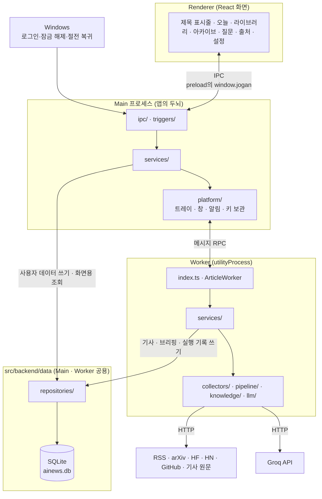

| 프로세스 | 역할 | 진입점 |
|---|---|---|
| Main | 트레이·창·알림·단축키, 생성 시점 감지, 미리 수집 타이머, 생성 흐름 제어, Worker 관리, API 키 암호화 보관. DB를 열어 스키마 변경을 적용하고, 사용자 데이터 쓰기와 화면용 조회를 직접 처리 | `src/main/index.ts` |
| Worker | 수집, 중복 합치기, LLM 호출, 본문 추출·번역, 태그 추천, 답변 생성. 기사·브리핑·실행 기록 쪽 테이블만 씀. 죽으면 Main이 3초 뒤 다시 띄움 | `src/worker/index.ts` |
| Renderer | 화면. `contextIsolation`·`sandbox`로 격리되어 preload가 노출한 함수만 씀 | `src/renderer/src/main.tsx` |

**Worker를 따로 두는 이유:** 수집·LLM 호출·본문 추출처럼 오래 걸리는 일이 Main을 막으면 트레이와 창이 멈춥니다. 별도 프로세스로 떼어 두면 작업 중에도 화면이 반응하고, Worker가 비정상 종료돼도 앱은 살아 있습니다.

**사용자 데이터를 Main이 맡는 이유:** 저장·메모·태그·하이라이트와 화면용 조회는 짧은 DB 작업입니다. Main이 자기 연결로 직접 처리하므로 Worker의 응답을 기다리지 않습니다.

**시작 순서:** Main이 DB를 열고 아직 적용하지 않은 스키마 변경을 적용한 다음(`src/backend/data/client.ts`의 `openDatabase`·`applyMigrations`) 저장소와 서비스를 조립하고, 그 뒤에 Worker를 띄웁니다. Worker는 같은 파일을 열기만 합니다. 종료할 때는 Main이 Worker를 끄고 자기 연결을 닫습니다.

### 2.2 프로세스 사이의 통신

| 구간 | 방식 | 계약 정의 |
|---|---|---|
| Renderer ↔ Main | Electron IPC. Renderer는 preload가 노출한 `window.jogan`만 사용 | `src/shared/ipc.ts` (`IPC` 채널, `JoganApi`) |
| Main ↔ Worker | utilityProcess 메시지. 요청마다 id를 붙인 RPC와, Worker가 먼저 보내는 알림(생성 진행 상황 `progress`·답변 조각 `chat-delta`·로그 `log`) | `src/shared/worker-protocol.ts` (`WorkerApi`, `MainToWorker`, `WorkerToMain`) |

화면에서 시작한 요청은 **Renderer → Main(ipc → service → repository) → DB** 순서로 내려가고, 결과는 같은 길로 돌아옵니다. 조회와 사용자 데이터 쓰기는 여기서 끝나고 Worker를 거치지 않습니다. 기사를 만들어 와야 하는 일만 Main의 서비스가 `WorkerClient`로 Worker를 부릅니다. Worker가 받는 호출은 다섯 가지입니다(`WorkerApi`).

| 호출 | 하는 일 | 부르는 곳 (Main) |
|---|---|---|
| `runPipeline` | 브리핑 생성(수집부터 게시까지). 결과로 브리핑 번호·날짜·오늘의 한 줄·기사 수·비용을 돌려줌 | `BriefingService.generate` |
| `collectOnly` | 낮 동안 수집만(LLM 없음) | `BriefingService.collectOnly` |
| `enrichItem` | 저장한 기사의 원문 본문 추출·보관과 태그 추천. 추천한 태그 이름을 돌려줌 | `ArticleService`(저장 후 보강) |
| `translateItem` | 본문 번역. 번역을 새로 만들었는지를 돌려줌 | `ArticleService.translateItem` |
| `answerQuestion` | 질문에 대한 답변 생성. 만드는 동안 조각을 `chat-delta`로 보내고, 끝나면 완성된 답변·인용 번호·모델을 돌려줌 | `ChatService.ask` |

이 밖에 Main은 시작 값(`init`: DB 경로·설정 폴더·API 키)과 바뀐 API 키(`set-api-key`)를 보내고, Worker는 준비되면 `ready`를 알립니다. Worker가 준비되기 전에 들어온 호출은 `WorkerClient`가 준비될 때까지 기다렸다가 보냅니다.

Worker는 호출의 결과와 세 가지 알림만 돌려줍니다. 결과를 사용자 데이터에 반영하는 일(추천 태그 붙이기, 보강 완료 표시, 질문·답변 저장)과 화면에 알리는 일(`item-updated`, `digest-updated`, 답변 완료·오류)은 Main의 서비스가 합니다. 화면으로 가는 알림은 **Main(`BroadcastEvents`) → 열려 있는 창**으로 전달됩니다. 생성 진행 상황은 Worker가 보낸 것을 그대로, 답변 조각은 `ChatService`를 거쳐 전달합니다.

### 2.3 Main 프로세스 계층

Main은 네 계층으로 나뉘고, 의존은 한 방향으로만 흐릅니다. 서비스는 DB를 `src/backend/data/repositories`의 저장소로만 읽고 씁니다(3.6절).

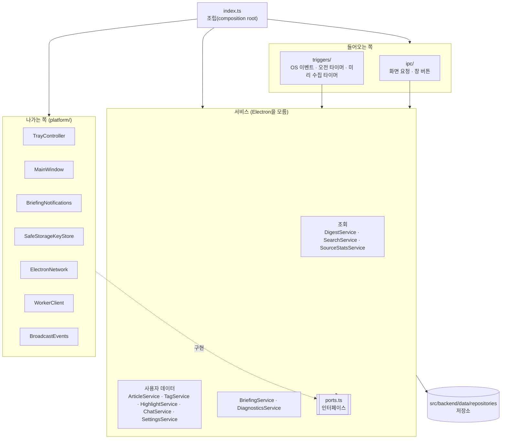

| 계층 | 폴더 | 하는 일 | 규칙 |
|---|---|---|---|
| 들어오는 쪽 | `ipc/`, `triggers/` | 화면 요청·OS 이벤트·타이머를 받아 서비스를 부름 | 판단·저장 로직 없음, platform을 직접 부르지 않음(창 버튼은 `WindowControls` 포트로 받음) |
| 서비스 | `services/` | 앱이 하는 일 자체와 그 규칙·트랜잭션 경계(아래 표) | Electron을 import하지 않음. 바깥 기능은 `ports.ts`의 인터페이스로만, DB는 주입받은 저장소로만 사용 |
| 나가는 쪽 | `platform/` | 포트의 실제 구현: 트레이(아이콘을 코드로 그림), 창(테두리 없는 창), Windows 알림, safeStorage, 네트워크 확인, 자동 시작, Worker 호출, 화면 방송 | 상태는 클래스 안에 둠 |
| 조립 | `index.ts` | DB를 열어 스키마 변경을 적용하고, 설정 파일을 읽고, 저장소와 위 객체들을 만들어 연결. 데이터 폴더를 `%APPDATA%\AINews`로 고정 | 로직 없음 |

| 서비스 | 파일 | 하는 일 |
|---|---|---|
| `DigestService` | `digest-service.ts` | 최신 브리핑·날짜별 브리핑·지난 브리핑 목록·마지막 브리핑 날짜 조회(읽기만) |
| `SearchService` | `search-service.ts` | 라이브러리·아카이브 검색(읽기만) |
| `SourceStatsService` | `source-stats-service.ts` | 출처 페이지 통계 조립(읽기만) |
| `ArticleService` | `article-service.ts` | 기사 상세 조회, 읽음, 저장·저장 해제, 메모, 번역 요청, 저장 후 보강(Worker 결과 반영과 화면 알림) |
| `TagService` | `tag-service.ts` | 태그 붙이기·떼기·목록, 이름 정리 규칙 |
| `HighlightService` | `highlight-service.ts` | 하이라이트 긋기·메모 수정·지우기, 겹친 범위 합치기 |
| `ChatService` | `chat-service.ts` | 대화 조회·질문·삭제, 질문과 답변 저장, 답변 조각 전달, 빠른 질문 목록 |
| `SettingsService` | `settings-service.ts` | API 키, 앱 설정(예산·브리핑 크기), 사용 비용 요약, 자동 시작 |
| `BriefingService` | `briefing-service.ts` | 브리핑 생성 흐름(네트워크 확인·상태 표시·Worker 실행·알림), 미리 수집 요청 전달 |
| `DiagnosticsService` | `diagnostics-service.ts` | 진단 화면용 기록·알림 테스트·네트워크 점검·트리거 상태 |

`ipc/`는 영역별 파일(`digest.ts` 브리핑·기사, `library.ts` 검색·태그 목록·지난 브리핑·출처 통계, `chat.ts`, `settings.ts`, `diagnostics.ts`, `window.ts`)로 나뉘고, 각 핸들러는 서비스에 요청을 전달만 합니다.

이 구조 덕분에 서비스는 Electron 없이 단위 테스트합니다(`services/*.test.ts`). 메모리 DB에 실제 저장소를 붙이고(`src/backend/data/testing.ts`의 `openTestDatabase`, `services/test-support.ts`), Worker와 화면 알림만 가짜로 대신합니다. 개발용 화면 캡처 도구는 `diagnostics/dev-screenshot.ts`에 있습니다(설치판에서는 동작하지 않음).

### 2.4 Worker 구성

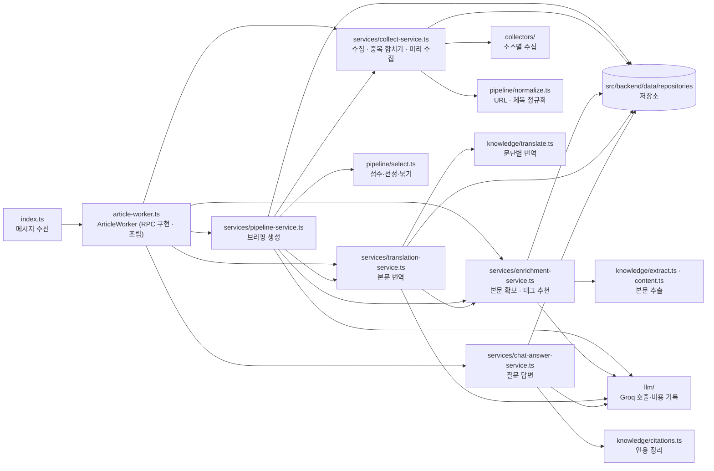

| 폴더·파일 | 내용 |
|---|---|
| `index.ts` | Worker 프로세스의 메시지 처리. `init`을 받으면 `ArticleWorker`를 만들고 `ready`를 알림. 호출(`rpc`)을 같은 이름의 메서드로 넘기고 결과를 같은 번호로 답함. 초기화에 실패하면 이유를 로그로 알리고 종료 |
| `article-worker.ts` | `ArticleWorker`: `WorkerApi`의 다섯 기능 구현이자 Worker의 조립. DB(열기만)와 설정을 열고 저장소·서비스를 만들어 연결. 시작할 때 `running`으로 남은 실행 기록을 정리 |
| `services/` | 규칙과 트랜잭션 경계. `CollectService`(수집·저장·같은 글 판정·같은 소식 합치기·미리 수집), `PipelineService`(브리핑 생성 전체 순서·예산 확인·게시·실행 기록), `EnrichmentService`(본문 확보 `ensureContent`, 저장한 기사 보강 `enrichItem`), `TranslationService`(번역 요청 `translateItem`, 생성 중 번역 `translateWithSession`), `ChatAnswerService`(근거 조립·스트리밍 답변·인용 정리) |
| `collectors/` | 소스 종류별 수집기(RSS, HF Papers, arXiv, Hacker News·Show HN, GitHub 릴리스). 피드는 fetch로 받아 넘김(gzip 응답 대응). 결과를 공통 형식(`RawItem`)으로 돌려줌 |
| `pipeline/` | URL·제목 정규화(`normalize.ts`), 점수·선정·묶기·본문 확인하며 채우기(`select.ts`, 순수 함수), LLM 출력 스키마(`schemas.ts`) |
| `knowledge/` | 기사 본문 추출(`extract.ts`), 원문에서 뽑을 기사인지 판단·문단 나누기(`content.ts`), 문단별 번역(`translate.ts`), 인용 정리·문단 고르기(`citations.ts`). DB를 쓰지 않는 규칙만 둠 |
| `llm/` | Groq 호출과 구조화 출력·스트리밍(`groq.ts`), 실행 단위 토큰 상한·동시 호출 제한·사용량 기록(`service.ts`의 `LlmSession`), 지금의 API 키로 세션을 여는 `LlmSessionFactory` |
| `log.ts` | Worker의 서비스가 쓰는 로그 함수의 모양(`WorkerLog`). 실제 전송은 `index.ts`가 함 |

`ArticleWorker`와 서비스는 Electron에 의존하지 않습니다. 서비스끼리 필요한 기능(`collectAndStore`, `mergeItemsInto`, `ensureContent`, `translateWithSession`)은 `ArticleWorker`가 함수로 이어 줍니다. Worker는 사용자 데이터 테이블에 쓰지 않습니다. 기존 태그 목록과 사용자 설정처럼 필요한 값은 읽기만 합니다.

#### Main과 Worker가 같이 쓰는 코드

| 폴더 | 내용 |
|---|---|
| `src/backend/data/` | DB 계층. 스키마(`schema.ts`), 연결·스키마 변경 적용·트랜잭션(`client.ts`), 변경 SQL(`migrations/`), 저장소(`repositories/`), 테스트용 메모리 DB(`testing.ts`). 3장 참고 |
| `src/backend/domain/` | 두 프로세스가 같은 규칙으로 판단해야 하는 것. 사용자 설정 읽기와 기본값(`app-settings.ts`의 `readAppSettings`), 이번 달·오늘 사용액과 절약 모드 판정(`usage.ts`의 `summarizeUsage`), 번역 대상 판정(`translation.ts`의 `needsTranslation`) |
| `src/backend/config/` | `config/` 폴더의 YAML·프롬프트 읽기(`index.ts`의 `loadConfig`), 역할별 모델 고르기(`modelSpecForRole`), 출처 설정을 문장으로 풀기(`describeSource`), 단가·비용 계산(`pricing.ts`). Main과 Worker가 시작할 때 각자 한 번 읽음 |
| `src/shared/` | 타입·계약(`types.ts`, `ipc.ts`, `worker-protocol.ts`), 생성 시점 규칙(`schedule.ts`), 제호 글자 모양(`wordmark.ts`). 화면 코드도 함께 씀 |

Main과 Worker 코드에서는 `@data/`·`@domain/`·`@config/`·`@shared/` 별칭으로 import합니다.

### 2.5 화면(Renderer) 구성

화면 코드는 **화면 단위**로 나누고, 여러 화면이 같이 쓰는 기능만 **도메인**으로 뺍니다. 공용 부품은 `common`에 작게 둡니다. import는 `@/`(= `src/renderer/src`) 별칭으로 씁니다.

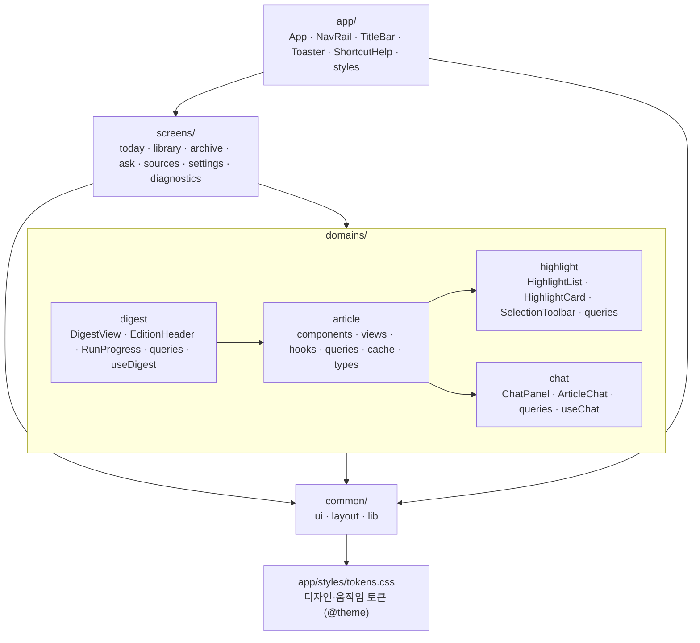

| 폴더 | 내용 |
|---|---|
| `app/` | `App.tsx`(제목 표시줄·메뉴 틀과 화면 이동 처리), `router.tsx`(주소와 화면 연결), `providers/`(`QueryProvider`: 쿼리 캐시와 Main 알림 연결), `layout/`(`NavRail` 제호·메뉴, `TitleBar` 제목 표시줄·창 버튼), `global/`(`Toaster`, `ShortcutHelp`), `styles/`(`tokens.css`, `app.css`, `fonts.ts`). 진입점 `main.tsx`는 `src/renderer/src` 바로 아래 |
| `screens/<화면>/` | `page.tsx`와, 그 화면에서만 쓰는 `components/`(출처 화면의 `Funnel`·`DailyBars`·`SourceTable`, 설정 화면의 `ApiKeyField`)와 `queries.ts`(설정·출처·진단 화면의 조회·변경 훅) |
| `domains/article/` | 한 도메인 안에서 역할별로 나눕니다. `components/`(목록 행 `ArticleRow`·`LibraryRow`·`RowReadButton`·`ArticleGroup`, 옆 패널 개요 `ArticlePreview`, 본문 `ArticleBody`, `MemoPad`·`TagList`·`WhyItMatters`), `views/`(기사 읽기 화면 `ArticleReader`, 목록+패널 조합 `ItemListView`), `hooks/`(`useAutoTranslate`·`useBodyMode`), `queries.ts`(조회·변경 훅), `cache.ts`(여러 캐시를 함께 고치는 `patchArticle`), `types.ts`(`ArticleView`·`ArticleActions`) |
| `domains/digest/` | 브리핑 한 호(`DigestView`: 오늘·아카이브 날짜별), 지면 머리, 생성 진행, `queries.ts`(브리핑·날짜 목록·만드는 중 여부·지금 만들기), 브리핑과 진행 상황을 묶은 `useDigest` |
| `domains/highlight/` | 하이라이트 목록·카드·선택 막대, 위치 계산(`highlight.ts`), `queries.ts`(긋기·메모·지우기), `cache.ts`(`setHighlights`) |
| `domains/chat/` | 질문 패널(`ChatPanel`), 읽기 화면의 질문 단(`ArticleChat`), `queries.ts`(지난 대화·빠른 질문·질문 보내기·지우기), 대화와 답변 스트리밍을 묶은 `useChat` |
| `common/ui/` | 기사를 모르는 기본 부품(버튼, 탭, 전환기, 대화상자, 입력, 자리 표시, 제호, 안내). 토큰 유틸리티만 사용 |
| `common/layout/` | 3단 틀(`AppShell`·`ListPane`·`DetailPane`·`SinglePane`), 너비 조절 손잡이, 단일 단 페이지 틀, 목록 머리 |
| `common/lib/` | Main 호출(`api`), 쿼리 키(`queryKeys`), 화면 주소(`paths`), 비용(`useUsageQuery`), `cn`, 날짜·금액 표시(`format`), 토스트(`toast`), 목록 단축키(`useListKeys`), 탭 밑줄 이동(`useSlidingIndicator`) |

의존은 `app → screens → domains → common` 한 방향이고, 도메인끼리는 `digest → article → highlight · chat`만 씁니다. 화면 쪽 공용 폴더를 `common`으로 부르는 것은 프로세스 공통 코드 `src/shared/`와 헷갈리지 않게 하려는 것입니다.

도메인 안의 파일이 늘면 도메인을 쪼개지 않고 `article`처럼 역할 폴더(`components/`·`views/`·`hooks/`)로 나눕니다. 폴더를 묶어 다시 내보내는 `index.ts`(배럴)는 두지 않고, 쓰는 파일을 직접 import합니다.

#### 화면 이동: React Router

화면 이동은 React Router(`react-router` 7)가 맡습니다. 주소와 화면의 연결은 `app/router.tsx`에, 주소를 만드는 함수는 `common/lib/paths.ts`에 모여 있습니다. 설치판은 화면을 `file://`로 열기 때문에 주소를 `#` 뒤에 붙이는 방식(`createHashRouter`)을 씁니다.

| 주소 | 화면 |
|---|---|
| `/today`, `/today/:itemId` | 오늘 브리핑 목록, 그 기사의 읽기 화면 |
| `/library`, `/library/:itemId` | 라이브러리 목록, 읽기 화면 |
| `/archive`, `/archive?q=검색어` | 아카이브 날짜 목록, 검색 결과 |
| `/archive/search/:itemId?q=검색어` | 검색 결과에서 연 읽기 화면 |
| `/archive/:date`, `/archive/:date/:itemId` | 그날 브리핑, 그 안의 읽기 화면 |
| `/ask`, `/sources`, `/settings`, `/diagnostics` | 질문, 출처, 설정, 진단 |

- **틀과 화면:** `App`이 제목 표시줄·메뉴를 그리고, 주소에 맞는 화면을 그 안(`Outlet`)에 표시합니다. 최신 브리핑과 생성 진행 상황은 `App`이 들고 있다가 오늘·질문 화면에 넘깁니다(`useOutletContext`). 화면을 옮겨도 진행 상황이 끊기지 않게 하기 위함입니다.
- **읽기 화면:** 어떤 기사를 읽는 중인지는 주소에 있습니다. 목록 뷰(`DigestView`, `ItemListView`)는 주소를 모르고 `readingItemId`·`onRead`만 받으며, 화면(`page.tsx`)이 `useReadingRoute`로 주소와 잇습니다. 목록에서 열면 방문 기록에 쌓이고, 읽는 중 이전·다음 기사로 옮기면 기록을 바꿔치기해서 뒤로 가면 바로 목록입니다.
- **뒤로·앞으로:** Alt+←/→와 마우스 옆 버튼을 `App`에서 처리합니다(Electron은 기본으로 처리하지 않음).
- **다른 화면에서 기사 열기:** 질문 화면의 인용은 `/today/기사번호`로 이동합니다. 따로 넘겨주는 상태가 없습니다.
- **Main의 화면 이동 요청**(알림 클릭, 트레이 메뉴)은 화면 이름(`Route`)으로 오고, `App`이 주소로 바꿔 이동합니다.

#### 화면 데이터: TanStack Query

화면이 Main(IPC)에서 받은 데이터는 모두 TanStack Query 캐시에 둡니다. 키는 `common/lib/queryKeys.ts`의 `queryKeys`에 모여 있습니다.

| 데이터 | 키 | 쓰는 곳 |
|---|---|---|
| 브리핑 | `['digest','latest']`, `['digest','date',날짜]` | 오늘, 아카이브 날짜별, 질문 화면, 제목 표시줄 |
| 날짜 목록 | `['digestList']` | 아카이브, 제목 표시줄의 호수 |
| 기사 상세 | `['item',id]` | 옆 패널 개요(라이브러리·검색), 기사 읽기 화면(본문·번역·하이라이트) |
| 검색 결과·태그 | `['search',조건]`, `['tags']` | 라이브러리, 아카이브 검색 |
| 대화·빠른 질문 | `['chat',범위]`, `['quickActions']` | 질문 단, 질문 화면 |
| 비용·설정·키·자동 시작 | `['usage']`, `['settings']`, `['apiKey']`, `['autostart']` | 메뉴 아래 비용, 설정 |
| 출처 통계 | `['sources',기간]` | 출처 |
| 만드는 중 여부 | `['running']` | 오늘 화면, 제목 표시줄 |
| 진단 | `['diag','trigger']`, `['diag','events']` | 진단 (열 때마다 새로 읽음) |
| 창 최대화 여부 | `['windowMaximized']` | 제목 표시줄의 창 버튼 |

- **조회·변경은 모두 훅:** 화면 컴포넌트는 `useQuery`·`useMutation`이나 `api`를 직접 부르지 않고, 각 폴더 `queries.ts`의 훅(`useItemDetailQuery`·`useToggleSaveMutation`·`useRunNowMutation`·`useAskChatMutation`·`useSettingsQuery` 등)만 씁니다. 여러 화면이 쓰는 데이터의 훅은 도메인에, 한 화면만 쓰는 훅은 그 화면 폴더에 둡니다. `api`를 직접 부르는 것은 데이터가 아닌 것뿐입니다(원문 열기, 창 최소화·닫기, Main 알림 구독).
- **언제 다시 읽나:** 데이터는 로컬 DB에서 오고, 바뀌는 때는 사용자 동작과 Main의 알림뿐입니다. 그래서 시간이 지났다고 다시 읽지 않고(`staleTime` 무한), 창 포커스·재시도로도 다시 부르지 않습니다. 바뀔 때 직접 고치거나 무효화합니다.
- **기사 고치기:** 같은 기사가 브리핑·검색 결과·상세 캐시에 따로 들어 있으므로, 저장·메모·태그·읽음은 `patchArticle`이 모든 캐시를 한꺼번에 고칩니다(먼저 화면에 반영하고 DB에 저장). 화면 컴포넌트는 `useArticleActions`(저장·메모·태그 변경 훅을 묶은 것)·`useMarkReadMutation`만 부르고, 목록끼리 상태를 넘겨주지 않습니다. 저장은 먼저 반영했다가 실패하면 되돌리고 알립니다.
- **Main 알림 연결** (`app/providers/QueryProvider.tsx`):
  - `item-updated`(저장 후 보강·번역 끝남): 그 기사 상세를 다시 읽고 새 태그·저장 여부를 목록에도 반영, "추천 중" 표시를 거두고 태그 목록을 무효화
  - `digest-updated`(새 브리핑): 브리핑·날짜 목록·비용·출처 통계를 무효화
  - 생성 끝: 비용을 무효화
- **저장 여부가 바뀌면** 저장 목록·날짜 목록·출처 통계를 "다음에 열 때 새로 읽기"로 표시합니다(지금 보는 목록은 그대로 둠).
- **캐시에 두지 않는 것:** 생성 진행 단계(`useDigest`가 받는 실시간 알림)와 지금 받는 답변 조각(`useChat`)처럼 흘러가는 값은 화면 상태로 둡니다. 어느 화면·어느 기사를 보는지는 주소에, 단축키 안내 같은 순수 화면 상태는 컴포넌트 상태에 두므로 별도 전역 스토어는 쓰지 않습니다.
- **알림으로 고치는 캐시:** 만드는 중 여부, 진단 이벤트 기록, 창 최대화 여부는 처음 한 번 읽고, 그 뒤로는 Main 알림이 올 때 훅 안에서 캐시를 고칩니다.

### 2.6 폴더 구조 요약

```
ai-news/
├─ config/            수집 소스, 관심 키워드, 역할별 모델, 단가, 빠른 질문, 프롬프트
├─ build/             앱 아이콘 (icon.png)
├─ src/
│  ├─ main/           Main 프로세스 (ipc · triggers · services · platform · diagnostics)
│  ├─ preload/        화면에 노출할 API (window.jogan)
│  ├─ worker/         Worker 프로세스 (services · collectors · pipeline · knowledge · llm)
│  ├─ backend/        Main · Worker가 같이 쓰는 코드 (화면은 쓰지 않음)
│  │  ├─ data/        DB 계층: 스키마 · 연결 · migrations · repositories
│  │  ├─ domain/      두 프로세스가 같이 쓰는 규칙 (설정 읽기 · 사용액 · 번역 대상 판정)
│  │  └─ config/      config/ 폴더의 설정 파일 읽기 · 단가 계산
│  ├─ renderer/       React 화면 (app · screens · domains · common)
│  └─ shared/         세 프로세스가 같이 쓰는 타입·계약·생성 시점 규칙·제호 글자 모양
├─ drizzle.config.ts  스키마 변경 SQL 생성 설정 (npm run db:generate)
├─ docs/              이 문서
└─ DESIGN.md          설계 과정과 결정 기록
```

### 2.7 설정과 데이터 위치

| 대상 | 위치 |
|---|---|
| 동작 설정 | `config/sources.yaml`, `interests.yaml`, `models.yaml`, `pricing.yaml`, `quick-actions.yaml`, `prompts/*.md` (설치판은 설치 폴더의 `resources/config`) |
| 설치 파일 | `npm run dist` → `dist/Jogan-Setup-<버전>.exe` (설정: `electron-builder.yml`, 아이콘: `build/icon.png`) |
| 스키마 변경 SQL | `src/backend/data/migrations/` (설치판은 설치 폴더의 `resources/migrations`) |
| 사용자 데이터 | `%APPDATA%\AINews\` — `ainews.db`(DB), `diagnostics.log`(진단 기록), `groq-key.bin`(암호화된 API 키). 표시 이름은 Jogan이지만 기존 데이터가 이어지도록 폴더 이름은 그대로 둠 |
| 사용자 설정 | DB의 `settings` 테이블(월 예산, 하루 상한, 브리핑 크기). 패널 너비·본문 보기 방식은 화면의 localStorage |

---

## 3. DB 구조

### 3.1 개요

- **엔진:** SQLite입니다. 드라이버는 `better-sqlite3`(동기 방식)이고, 쿼리는 Drizzle ORM으로 작성합니다. 파일은 `%APPDATA%\AINews\ainews.db` 하나입니다.
- **접근:** Main과 Worker가 각자 연결을 하나씩 열어 같은 파일을 씁니다. DB 코드는 두 프로세스가 같이 쓰는 `src/backend/data/`에 있습니다. 쿼리는 `repositories/`의 저장소 안에만 있고, 서비스는 저장소의 메서드로만 DB를 읽고 씁니다(3.6절).
- **설정:** WAL 모드, 외래 키 사용, 잠금 대기 5초 (`src/backend/data/client.ts`의 `openDatabase`).
- **스키마:** `src/backend/data/schema.ts`가 테이블 16개의 컬럼·타입·기본값·인덱스를 Drizzle 테이블 정의로 선언합니다. 저장소는 이 정의로만 쿼리를 쓰고, 쿼리 결과의 타입도 여기서 나옵니다. 전문 검색 테이블 `search_fts`는 FTS5 가상 테이블이라 이 파일에 없고 직접 쓴 SQL로 만듭니다. 합쳐서 테이블은 17개입니다. 시각은 모두 ISO 문자열이고, JSON 컬럼은 타입을 붙여 읽고 씁니다.
- **마이그레이션:** `schema.ts`를 고친 뒤 `npm run db:generate`(`drizzle-kit generate`, 설정은 `drizzle.config.ts`)로 `src/backend/data/migrations/`에 변경 SQL을 만듭니다. Main이 시작할 때 `applyMigrations`(`src/backend/data/client.ts`)가 아직 적용하지 않은 파일을 적용합니다. Worker를 띄우기 전에 끝내고, Worker는 적용하지 않습니다. 설치판은 이 폴더를 `resources/migrations`로 함께 싣습니다(`electron-builder.yml`의 `extraResources`).

| 파일 | 내용 |
|---|---|
| `0000_initial.sql` | `drizzle-kit`이 `schema.ts`에서 생성한 테이블 16개와 인덱스 |
| `0001_search_fts.sql` | 직접 쓴 SQL. 전문 검색 색인 `search_fts`(FTS5, trigram) |
| `meta/` | 적용 순서(`_journal.json`)와 스키마 스냅샷 |

### 3.2 관계도

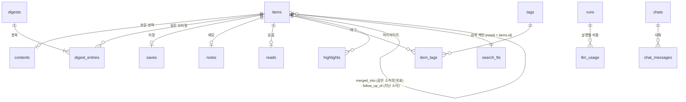

중심은 `items`(수집한 기사 한 건)입니다. 브리핑은 `digests`(하루 한 호)와 `digest_entries`(그 호에 실린 기사와 순위·섹션)로 이루어지고, 사용자의 동작(저장·메모·읽음·태그·하이라이트)은 모두 기사에 1:1 또는 1:N으로 붙습니다.

### 3.3 테이블

#### items — 수집한 기사

기사 한 건의 원본 정보, LLM 선별 결과, 한국어 요약을 한 행에 담습니다.

| 열 묶음 | 열 | 설명 |
|---|---|---|
| 식별 | `id`, `url_key`(고유) | `url_key`는 정규화한 URL. 같은 글이면 같은 값 (arXiv abs·pdf·HF Papers는 모두 `arxiv:<id>`) |
| 원본 | `url`, `source_id`, `source_name`, `kind`, `title`, `snippet`, `lang`, `published_at`, `collected_at` | `kind`: news / paper / community / release |
| 중복 판정 | `title_norm` | 소문자·기호 제거한 제목. 최근 3일 안에 같은 제목이면 같은 기사로 봄 |
| 화제성 | `engagement`, `engagement_label` | HN 점수·HF 추천수 등 대표 참여도와 표시 문구("HN 747점") |
| 다른 출처 | `other_sources` | 같은 소식을 다룬 다른 출처 목록(JSON: 출처 이름·URL·참여도) |
| 같은 소식 묶기 | `merged_into` | 다른 기사의 대표로 합쳐졌으면 그 대표의 `id`. 값이 있으면 다음 후보에서 빠짐. 지난 7일 브리핑 기사와 같은 소식이면 그 지난 기사로 합쳐짐 |
| 후속 소식 | `follow_up_of` | 지난 7일 브리핑 기사의 중요한 새 전개면 그 지난 기사의 `id`. 화면에 "후속" 표시 |
| LLM 선별 | `triage_category`, `triage_relevance`, `triage_importance`, `triaged_at` | 분류(model_release / tools / applied / research / community / industry / other), 관련도(0~1), 중요도(1~5). 한 번 매기면 다시 매기지 않음 |
| 한국어 요약 | `title_ko`, `summary_ko`, `key_points`, `why_ko`, `summary_model`, `summarized_at` | 한 번 요약하면 다시 요약하지 않음(비용 절감) |

#### contents — 기사 본문과 번역

| 열 | 설명 |
|---|---|
| `item_id` (PK) | 기사 |
| `paragraphs` | 문단 목록(JSON). 문단 순서가 곧 화면의 ¶ 번호이고, 하이라이트와 AI 답변 인용의 기준 |
| `full_text` | 1이면 원문에서 본문을 추출함, 0이면 추출에 실패해 RSS 요약·논문 초록·릴리스 노트만 있음 |
| `extracted_at` | 추출 시각 |
| `paragraphs_ko` | 문단별 한국어 번역(JSON). `paragraphs`와 같은 길이·순서라 ¶ 번호가 원문과 같음. 번역 상한을 넘은 문단은 `null`. 한국어 기사나 아직 번역하지 않은 기사는 열 전체가 `NULL` |
| `translated_at`, `translate_model` | 번역 시각과 모델 |

본문은 두 시점에 채워집니다. 브리핑 후보로 확인할 때(요약의 입력이자, 본문이 충분한지 판단)와 사용자가 저장할 때(보관)입니다. 본문을 다시 추출하면 문단이 바뀌므로 번역은 지우고 다시 번역합니다.

#### digests / digest_entries — 브리핑

| 테이블 | 열 | 설명 |
|---|---|---|
| `digests` | `id`, `date`(고유), `headline`, `overview`, `stats`, `created_at` | 하루 한 호. `stats`(JSON): 소스 수, 새로 수집한 수, 후보 수, 선정 수, 비용, 실패한 소스, 절약 모드 여부 |
| `digest_entries` | `digest_id`, `item_id`, `rank`, `section`, `why_it_matters` | 그 호에 실린 기사. `section`은 상위 5개면 `top`, 나머지는 분류 이름 |

#### 사용자 동작

| 테이블 | 열 | 설명 |
|---|---|---|
| `saves` | `item_id`(PK), `saved_at`, `enriched_at` | 저장한 기사. `enriched_at`은 저장 후 본문 보관·태그 추천을 마친 시각 |
| `notes` | `item_id`(PK), `body`, `updated_at` | 기사별 메모. 메모를 쓰면 `saves`에도 자동으로 들어감. 빈 메모는 행을 지움 |
| `reads` | `item_id`(PK), `read_at` | 읽음 표시 (목록에서 처음 골랐을 때) |
| `tags` | `id`, `name`(고유, 대소문자 무시) | 태그. 소문자·하이픈으로 통일. 하이픈만 다른 기존 태그가 있으면 그 표기를 씀. 어떤 기사에도 안 쓰이면 지움 |
| `item_tags` | `item_id`, `tag_id`, `source` | 기사-태그 연결. `source`: auto(AI 추천) / user(직접 입력) |
| `highlights` | `id`, `item_id`, `paragraph`, `variant`, `start_offset`, `end_offset`, `text`, `note`, `created_at` | 하이라이트. `paragraph`는 ¶ 번호, `variant`는 그은 판(ko 번역문 / original 원문), 위치는 그 문단 글자 안의 [start, end). 그은 글자를 `text`로 함께 보관해서 본문이 바뀌어 위치가 어긋나면 글자로 다시 찾음. 같은 문단·같은 판에서 겹치면 하나로 합침. 하이라이트를 그으면 `saves`에도 자동으로 들어감 |

#### AI 질문 대화

| 테이블 | 열 | 설명 |
|---|---|---|
| `chats` | `id`, `scope_key`(고유), `created_at`, `updated_at` | 대화 하나. `scope_key`는 범위: `item:<기사 id>`(기사 채팅) 또는 `digest:<날짜>`(그날 브리핑 채팅). 범위마다 대화는 하나 |
| `chat_messages` | `chat_id`, `role`, `content`, `citations`, `model`, `created_at` | 질문(user)과 답변(assistant). 답변의 `content`에는 인용 표시(`[¶3]` 또는 `[#3]`)가 그대로 들어 있고, `citations`(JSON)에는 실제로 있는 번호만 남긴 인용 목록 |

대화는 기사·날짜를 외래 키로 묶지 않고 `scope_key` 문자열로 찾습니다. 대화를 지우면 `chats` 행을 지우고, 메시지는 함께 지워집니다.

#### 운영 기록

| 테이블 | 열 | 설명 |
|---|---|---|
| `runs` | `id`, `reason`, `started_at`, `finished_at`, `status`, `since`, `error`, `stats` | 브리핑 생성 실행 한 번. `since`는 이번 수집 구간의 시작으로, 다음 실행의 수집 구간을 정하는 데 쓰임. 앱이 중간에 꺼져 `running`으로 남은 실행은 다음 시작 때 오류로 정리. 미리 수집은 실행 기록을 남기지 않음 |
| `llm_usage` | `at`, `run_id`, `role`, `model`, 입력·캐시·출력·추론 토큰, `latency_ms`, `cost_usd` | LLM 호출 한 번(`role`: triage·cluster·recent·summary·translate·digest·tags·chat). 월·일 사용액 계산(예산 확인)과 실행별 비용에 쓰임. 태그 추천·질문·열 때 번역처럼 실행 밖의 호출은 `run_id`가 비어 있음 |
| `settings` | `key`, `value` | 사용자 설정(JSON 값): 월 예산, 하루 상한, 브리핑 크기. 저장하지 않은 항목은 코드의 기본값 사용 |
| `source_fetches` | `source_id`, `at`, `reason`, `ok`, `fetched`, `new_items`, `error` | 출처별 수집 한 번. `reason`: briefing(브리핑 생성) / collect(미리 수집). 받은 글 수와 그중 처음 본 글 수, 실패 이유. 출처 페이지의 상태·실패 기록에 쓰이고, 90일보다 오래된 기록은 수집할 때 지움 |

### 3.4 전문 검색 색인 (search_fts)

라이브러리·아카이브 검색을 위한 SQLite FTS5 가상 테이블입니다. `rowid`가 `items.id`와 같습니다.

| 열 | 들어가는 내용 |
|---|---|
| `title` | 원제 + 한국어 제목 |
| `body` | 한국어 요약, 핵심 포인트, RSS 요약, 본문 문단 전체, 본문 번역 |
| `memo` | 메모, 하이라이트 글자와 하이라이트 메모 |

- **토크나이저:** `trigram`. 띄어쓰기로 낱말을 나누지 않고 3글자 단위로 색인해서, 조사가 붙은 한국어("모델을")도 부분 일치로 찾습니다.
- **2글자 검색어:** trigram은 3글자 미만을 찾지 못하므로, "모델"처럼 짧은 낱말은 같은 테이블에서 LIKE로 찾습니다. 여러 낱말은 모두 포함하는 기사만(AND) 찾습니다 (`src/backend/data/repositories/search-repository.ts`의 `buildQueryConditions`).
- **색인 갱신:** 색인에 들어가는 내용을 바꾼 서비스가 같은 트랜잭션 안에서 `SearchRepository.reindexItem`을 부릅니다. Worker 쪽은 새 기사 저장(`CollectService`), 요약 저장(`PipelineService`), 본문 저장(`EnrichmentService`), 번역 저장(`TranslationService`)이고, Main 쪽은 메모 저장·저장 후 보강 완료(`ArticleService`), 하이라이트 변경(`HighlightService`)입니다. `reindexItem`은 그 기사의 색인 행을 지우고 지금의 `items`·`contents`·`notes`·`highlights` 내용으로 다시 넣습니다.
- **두 프로세스가 쓰는 유일한 테이블:** 색인은 Worker가 쓰는 내용과 Main이 쓰는 내용을 함께 담으므로 양쪽이 다 갱신합니다(3.6절).

### 3.5 화면용 읽기

화면에 보내는 기사 정보는 여러 테이블을 합쳐서 만듭니다. 저장소가 기사에 저장 여부, 메모, 읽음, 태그 목록, 실린 브리핑 날짜, 후속 소식이면 지난 기사 제목·날짜를 붙여 화면용 모양(DTO)으로 돌려주고, Main의 서비스가 이것을 그대로 또는 규칙을 더해 화면에 넘깁니다. 화면용 조회는 모두 Main에서 일어납니다.

| 형태 | 서비스 (Main) | 저장소 | 쓰는 곳 |
|---|---|---|---|
| 브리핑 한 호 | `DigestService.getLatestDigest`, `getDigestByDate` | `DigestRepository.findLatestDigest`, `findDigestByDate` | 오늘 화면, 아카이브의 날짜별 보기 |
| 지난 브리핑 목록 | `DigestService.listDigests` | `DigestRepository.listDigestSummaries` | 아카이브 날짜 목록 |
| 검색 결과 목록 | `SearchService.search` (범위: 저장한 기사 / 브리핑에 실린 기사) | `SearchRepository.searchItems` | 라이브러리, 아카이브 검색 |
| 기사 상세 | `ArticleService.getItemDetail` (본문 문단, 문단별 번역, 하이라이트 포함. 번역 상태는 서비스가 정해서 붙임) | `ItemRepository.findItemDetail` | 옆 패널 개요(라이브러리), 기사 읽기 화면, 저장 후·번역 후 갱신 |
| 태그 목록 | `TagService.listTagCounts` | `TagRepository.listTagCountsOnSavedItems` | 라이브러리의 태그 필터 |

### 3.6 계층 규칙과 테이블 소유

#### 계층

DB를 쓰는 코드는 세 계층으로 나뉘고, 위에서 아래로만 부릅니다.

| 계층 | 위치 | 하는 일 |
|---|---|---|
| controller | Main `src/main/ipc/*`, Worker `src/worker/index.ts` | 요청을 받아 서비스(Worker는 `ArticleWorker`를 거쳐)에 전달. 판단·저장 없음 |
| service | `src/main/services/`, `src/worker/services/` | 업무 규칙과 트랜잭션 경계. 여러 쓰기를 `runInTransaction`(`src/backend/data/client.ts`)으로 묶고, 검색 색인을 언제 다시 쓸지도 여기서 정함 |
| repository | `src/backend/data/repositories/*-repository.ts` | 읽고 쓰기만. 규칙을 넣지 않음 |

- 저장소 파일은 11개이고, 파일마다 인터페이스(`ItemRepository` 등)와 그것을 만드는 함수(`createItemRepository(database)` 등)가 하나씩 있습니다. Main과 Worker는 조립할 때(`src/main/index.ts`, `src/worker/article-worker.ts`) 자기 연결로 필요한 저장소를 만들어 서비스에 넘깁니다.
- 규칙은 서비스에 둡니다. 예를 들어 "메모를 쓰면 기사를 자동 저장", "빈 메모는 삭제"는 `ArticleService`에, "겹친 하이라이트 합치기"는 `HighlightService`에, "같은 글 판정"은 `CollectService`에, "같은 날짜면 브리핑 내용 교체"는 `PipelineService`에 있고, 저장소는 그 조각이 되는 읽기·쓰기만 제공합니다.
- `runInTransaction`은 동기 함수만 받습니다. 트랜잭션 안에서 네트워크나 LLM 응답을 기다릴 수 없으므로 잠금을 오래 쥐는 일이 없습니다.
- 저장소 테스트(`repositories/*-repository.test.ts`)와 서비스 테스트는 메모리 DB(`src/backend/data/testing.ts`의 `openTestDatabase`)에 실제 변경 SQL을 적용해 실행합니다.

| 저장소 | 다루는 테이블 |
|---|---|
| `item-repository.ts` | `items`, `contents` (화면용 기사 조회 포함) |
| `digest-repository.ts` | `digests`, `digest_entries` (화면용 브리핑 조회 포함) |
| `run-repository.ts` | `runs` |
| `llm-usage-repository.ts` | `llm_usage` |
| `source-fetch-repository.ts` | `source_fetches` (출처 페이지 통계의 집계 조회 포함) |
| `library-repository.ts` | `saves`, `notes`, `reads` |
| `tag-repository.ts` | `tags`, `item_tags` |
| `highlight-repository.ts` | `highlights` |
| `chat-repository.ts` | `chats`, `chat_messages` |
| `settings-repository.ts` | `settings` |
| `search-repository.ts` | `search_fts` (색인 다시 쓰기와 검색) |

#### 테이블마다 쓰는 프로세스는 하나

| 쓰는 프로세스 | 테이블 | 다른 프로세스 |
|---|---|---|
| Worker | `items`, `contents`, `digests`, `digest_entries`, `runs`, `llm_usage`, `source_fetches` | Main은 읽기만 (화면용 조회, 비용 요약, 출처 통계) |
| Main | `saves`, `notes`, `reads`, `tags`, `item_tags`, `highlights`, `settings`, `chats`, `chat_messages` | Worker는 필요한 것만 읽음 (예: 사용자 설정, 기존 태그 목록) |
| Main · Worker | `search_fts` | 원본 테이블에서 만드는 파생 색인. 기사 단위로 다시 씀 |

이 구분 때문에 Worker의 결과를 사용자 데이터에 반영하는 일은 Main이 합니다. Worker는 추천한 태그 이름과 완성된 답변을 돌려주기만 하고, 태그를 붙이고(`item_tags`) 보강 완료를 표시하고(`saves.enriched_at`) 질문·답변을 저장하는(`chat_messages`) 것은 Main의 서비스입니다.

#### 한 파일에 연결 둘이 안전한 이유

- **WAL 모드:** 한쪽이 쓰는 동안에도 다른 쪽이 읽을 수 있습니다. Worker가 브리핑을 만들며 쓰는 중에도 Main의 화면용 조회는 막히지 않습니다.
- **잠금 대기 5초:** 두 연결이 동시에 쓰려 하면 뒤에 온 쪽이 5초까지 기다립니다. 트랜잭션은 동기 함수라 짧게 끝나므로 기다림도 짧습니다.
- **테이블마다 쓰는 쪽이 하나:** 같은 행을 두 프로세스가 서로 고치는 일이 없어, 한쪽이 읽은 값을 바탕으로 쓴 내용을 다른 쪽이 덮어쓰는 충돌이 생기지 않습니다.
- **`search_fts`는 예외지만 파생 데이터:** `reindexItem`은 한 트랜잭션 안에서 그 기사의 색인 행을 지우고 그때의 원본 테이블 내용으로 다시 넣습니다. 어느 프로세스가 갱신하든 결과는 원본에서 다시 만든 한 행입니다.
- **스키마 변경은 Main만:** Main이 Worker를 띄우기 전에 적용을 끝내므로, 두 프로세스가 스키마를 동시에 바꾸거나 Worker가 옛 스키마를 보는 일이 없습니다.

---

## 4. 주요 흐름

### 4.1 브리핑을 언제 만드는가

브리핑은 하루에 한 번 만듭니다. "지금 만들어야 하나?"는 다섯 가지 계기에서 같은 규칙으로 판단합니다.

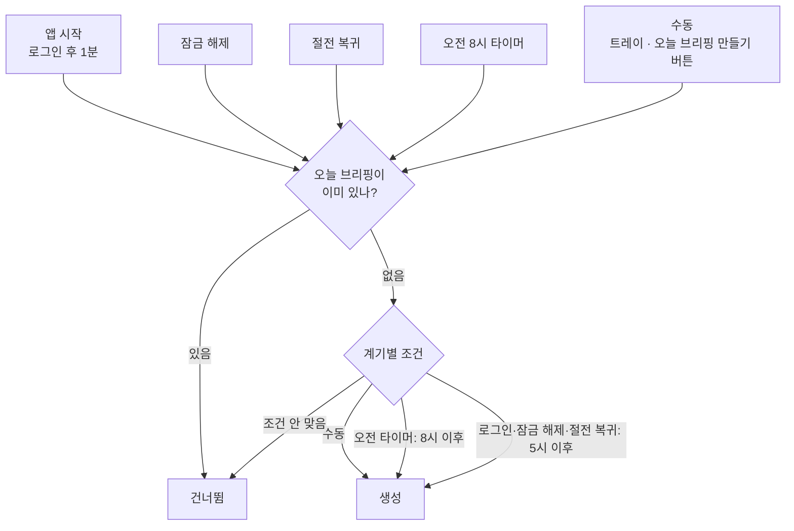

- **판단 규칙:** `src/shared/schedule.ts`의 `shouldGenerate` (순수 함수, 단위 테스트로 고정).
  - 8시 전에 로그인해도 5시 이후면 "일찍 출근"으로 보고 바로 만듭니다. 그러면 그날 8시 타이머는 오늘 브리핑이 이미 있어서 건너뜁니다.
  - 새벽 5시 전의 잠금 해제는 전날 밤 작업으로 보고 만들지 않습니다.
- **오늘 브리핑이 있는지:** Main이 `DigestService.getLastDigestDate`로 DB에서 직접 읽습니다.
- **계기 감지:** `src/main/triggers/briefing-triggers.ts`의 `BriefingTriggers`. Windows의 잠금 해제·절전 복귀 이벤트를 듣고, 다음 오전 8시까지 남은 시간만큼 타이머를 겁니다. 절전에서 깨어나면 타이머를 다시 계산합니다. 조건이 맞으면 생성을 시작만 하고(기다리지 않음) 시작 여부를 돌려줍니다.
- **다시 만들기는 없습니다:** 오늘 브리핑이 있으면 수동 요청도 건너뜁니다. 같은 날 후보는 거의 같고 선별·요약 결과도 다시 쓰므로 결과가 비슷하고, 낮 동안 쌓인 새 글은 다음 날 브리핑에 들어가기 때문입니다. 화면의 "오늘 브리핑 만들기"는 오늘 것이 없거나 생성이 실패했을 때만 보입니다. 건너뛰면 `runNow`가 false를 돌려줘 화면이 "준비 중"에서 멈추지 않고, 트레이의 "지금 브리핑 만들기"는 창을 엽니다.

#### 낮 동안 미리 수집

- PC가 켜져 있는 동안 **2시간마다 수집만** 합니다(`triggers/collect-timer.ts`의 `CollectTimer` → `BriefingService.collectOnly` → Worker `collectOnly` → `CollectService.collectOnly`). LLM은 부르지 않으므로 비용이 들지 않습니다.
- 최근 24시간 글을 받아 쌓고, 중복은 DB에서 거릅니다(파이프라인 ①②와 같은 `CollectService.collectAndStore`).
- 아침 브리핑은 "지난 실행 이후 쌓인 글"을 후보로 쓰므로, Reddit 인기글·GitHub 릴리스처럼 피드에서 금방 밀려나거나 아침 수집 구간보다 일찍 나온 글도 놓치지 않습니다.
- 10분마다 "마지막 수집 후 2시간이 지났나"를 확인합니다(절전으로 타이머가 밀려도 맞게). 첫 수집은 앱 시작 2시간 뒤이고, 오프라인이거나 브리핑을 만드는 중이면 건너뜁니다. Worker 쪽에서도 브리핑을 만드는 중이거나 이미 수집 중이면 건너뜁니다.

### 4.2 브리핑 생성: Main 쪽 흐름

생성이 결정되면 Main의 `BriefingService.generate`(`src/main/services/briefing-service.ts`)가 전체 흐름을 이끕니다. 실제 수집·요약은 Worker가 하고, Main은 그 앞뒤(네트워크 확인, 상태 표시, 알림)를 맡습니다.

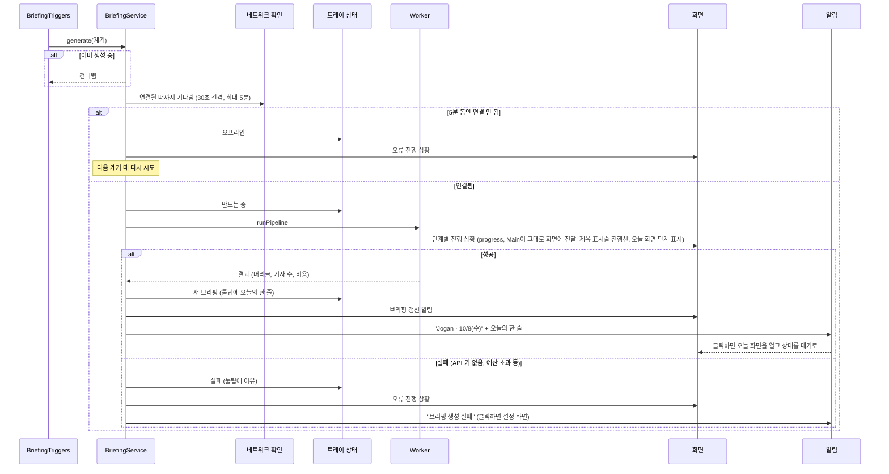

- 네트워크 확인은 단순한 온라인 여부가 아니라 Groq 서버까지 실제로 닿는지 봅니다(`platform/network.ts`). 로그인 직후 Wi-Fi·VPN이 늦게 붙는 경우를 위한 것입니다.
- 생성 중에 또 계기가 오면 두 번째 요청은 건너뜁니다. Worker 쪽에도 같은 보호가 있습니다(`PipelineService.runPipeline`은 이미 만드는 중이면 오류로 답함).

### 4.3 브리핑 생성: Worker 파이프라인

Worker의 `PipelineService.runPipeline`(`src/worker/services/pipeline-service.ts`)이 수집부터 게시까지 한 번에 진행합니다. 수집·저장은 `CollectService`, 본문 확보는 `EnrichmentService`, 번역은 `TranslationService`에 맡기고, 단계마다 진행 상황(`progress`)을 보냅니다. 이 흐름에서 쓰는 테이블은 모두 Worker가 쓰는 테이블입니다.

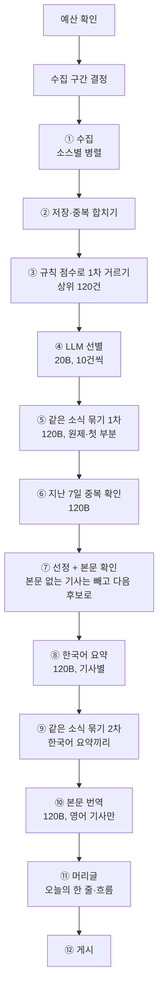

#### 예산 확인
- 이번 달·오늘의 LLM 사용액을 `llm_usage`에서 합산합니다(`src/backend/domain/usage.ts`의 `summarizeUsage`). 월 예산·하루 상한은 Main이 저장한 `settings`를 읽습니다(`src/backend/domain/app-settings.ts`의 `readAppSettings`).
- 오늘 사용액이 **하루 상한**(기본 $0.5) 이상이면 생성을 중단합니다.
- 이번 달 사용액이 **월 예산**(기본 $5) 이상이면 **절약 모드**로 실행합니다. 요약·머리글도 작은 모델(20B)로 바꾸고, 브리핑 크기를 15건으로 줄이고, 본문 번역은 미리 하지 않고 기사를 열 때 합니다(`src/backend/config/index.ts`의 `modelSpecForRole`).

#### 수집 구간 결정
- "오늘 이전에 성공한 마지막 실행"의 시작 시각부터 지금까지를 모읍니다. 월요일에는 자연스럽게 주말 소식이 들어갑니다.
- 첫 실행이면 최근 24시간, 오래 비웠으면 최대 72시간까지만 모읍니다.
- 실행 기록은 `runs`에 남습니다.

#### ① 수집
- `config/sources.yaml`의 켜진 소스마다 `collectSource`(`collectors/index.ts`)를 동시에 실행합니다. RSS·HF Papers·arXiv·Hacker News·GitHub 릴리스 수집기가 결과를 같은 형식으로 돌려줍니다.
- 소스 하나가 실패해도(타임아웃 15초) 나머지는 계속 진행하고, 실패한 소스는 브리핑 통계에 기록합니다.
- `keywordFilter`가 켜진 피드(GeekNews·국내 기술블로그 등)는 관심 키워드에 맞는 글만, Hacker News는 키워드로 검색해 60점 이상, Show HN은 30점 이상만 가져옵니다. Reddit r/LocalLLaMA는 하루 인기글 피드의 앞 15개만 받습니다(`maxItems`).
- **GitHub 릴리스:** 감시 목록의 저장소마다 `releases.atom`을 읽어 메이저·마이너 버전(x.y, x.y.0)만 받습니다. 패치 버전과 rc·beta·dev 같은 프리릴리스는 버립니다(`releaseVersion`). 한 저장소에서 여러 패키지를 내면(`langchain-ai/langgraph`) `match`로 패키지를 고릅니다. 저장소 하나가 실패해도 나머지는 받습니다. 릴리스 노트가 곧 본문입니다.

#### ② 저장·중복 합치기
- 수집한 글을 하나씩 `CollectService.storeRawItem`으로 저장합니다. 출처 하나의 글과 그 출처의 수집 기록(`source_fetches`)을 한 트랜잭션으로 묶습니다.
- **같은 글 판정:** 정규화한 URL(`urlKey`: 추적 파라미터·www·끝의 / 제거, arXiv 주소 통일)이 같거나, 최근 3일 안에 정규화한 제목이 같으면 같은 글입니다.
- 같은 글이 다른 출처에서 또 들어오면 새로 만들지 않고, 그 출처를 `other_sources`에 붙이고 참여도는 큰 값을 남깁니다.

#### ③ 규칙 점수로 1차 거르기
- 후보는 수집 구간 안에 들어왔고, 다른 기사에 합쳐지지 않았고, 오늘이 아닌 날의 브리핑에 실린 적이 없는 기사입니다(`ItemRepository.listBriefingCandidates`). 미리 수집한 글도 여기에 들어옵니다.
- LLM 비용을 줄이려고 먼저 규칙으로 점수를 매깁니다(`select.ts`의 `ruleScore`). 소스 신뢰도, 관심 키워드(`config/interests.yaml`), 참여도, 다른 출처 수, 최신성을 더한 값입니다.
- 상위 120건만 다음 단계로 넘깁니다.

#### ④ LLM 선별
- 아직 선별하지 않은 기사만 10건씩 묶어 20B 모델에 보냅니다. 제목과 첫 200자만 넘겨서 입력을 작게 유지합니다.
- 기사마다 분류(모델 출시 / 도구·라이브러리 / 실전·응용 / 논문 / 커뮤니티 / 업계·정책 / 그 외), 관련도(0~1), 중요도(1~5)를 받아 `items`에 저장합니다. 프롬프트(`config/prompts/triage.md`)는 독자를 "AI로 제품을 만드는 개발자"로 두고, 바로 써볼 도구와 수치가 담긴 구현 경험을 높게, 홍보성 글과 패치 수준 업데이트를 낮게 매기게 합니다. 실전·응용은 "어떻게 만들고 운영하는가"가 중심인 글만이고 제품 출시 소식은 아닙니다.
- 한 번 매긴 결과는 다시 쓰므로 같은 기사로 비용이 두 번 들지 않습니다. 모든 배치가 실패하면(키·네트워크 문제) 생성을 중단하고, 일부만 실패하면 나머지로 진행합니다.

#### ⑤ 같은 소식 묶기 (1차)
- 최종 점수 상위 후보(브리핑 크기의 두 배)를 120B 모델에 보내, 같은 발표를 다룬 기사끼리 묶게 합니다. 공식 발표·보도·커뮤니티 글처럼 출처나 언어가 달라도 같은 발표면 한 묶음입니다.
- 묶음마다 LLM이 **원본에 가장 가까운 기사**(공식 발표 > 보도 > 커뮤니티)를 대표로 고릅니다.
- 대표가 아닌 기사는 `merged_into`로 표시해 다음 후보에서 빠지고, 그 출처는 대표의 `other_sources`로 옮겨집니다(`select.ts`의 `applyClusters`, `CollectService.mergeItemsInto`). 대표는 묶인 기사들의 참여도·중요도 중 큰 값을 물려받습니다.

#### ⑥ 지난 7일 중복 확인
- 1차로 묶은 상위 후보를 지난 7일 브리핑에 실린 기사 목록(오늘 브리핑 제외, `DigestRepository.listPublishedItemsBetween`)과 함께 120B에 보내, 이미 보낸 소식인지 가립니다(`config/prompts/recent.md`). 출처·언어가 달라도 같은 발표면 같은 소식입니다.
- **이미 보낸 소식:** 후보에서 빼고, 지난 기사에 출처로 붙입니다(`mergeItemsInto`). 빠진 자리는 다음 후보로 채웁니다.
- **후속 소식:** 같은 소식이지만 중요한 새 전개(발표 → 실제 출시, 새 수치·가격, 정책 확정, 판결 등)면 싣되 `follow_up_of`에 지난 기사를 표시합니다. 목록에 "후속" 배지, 읽기 화면에 "지난 10/7(수) 브리핑에 실린 …의 새 전개" 안내가 나옵니다.
- 실패하면 확인 없이 진행합니다. 호출 한 번, 약 $0.001입니다.

#### ⑦ 선정과 본문 확인
- **점수:** 최종 점수(`finalScore`)는 "중요도 × 관련도"를 중심으로 참여도·다른 출처 수·규칙 점수를 더한 값입니다. 관련도 0.4 미만은 빼되, 중요도 5짜리는 "그 외 주요 소식"으로 남깁니다.
- **최소 몫:** 도구·라이브러리 3건, 실전·응용 2건을 먼저 채웁니다. 큰 뉴스에 밀려 개발자에게 쓸모 있는 소식이 빠지지 않게 하려는 것입니다. 단, 관련도 0.6·중요도 2 이상인 후보만 몫으로 넣습니다.
- **상한:** 나머지 자리는 분류별 상한(논문 3, 커뮤니티 4, 업계 3, 그 외 3)을 지키며 점수 순으로 브리핑 크기(기본 20건)까지 채웁니다. 순위는 몫으로 들어온 기사도 점수대로 매기고, 상위 5건은 "오늘의 톱" 섹션, 나머지는 자기 분류 섹션에 들어갑니다(`selectEntries`).
- **본문 확보:** 고른 기사 중 본문이 아직 없는 것은 원문 페이지에서 추출합니다(`EnrichmentService.ensureContent` → `knowledge/extract.ts`의 `extractArticle`: Readability로 기사 영역을 찾고 문단으로 나눔). 논문은 초록을, 릴리스는 릴리스 노트를, HN·Reddit 토론 페이지와 추출에 실패한 기사(403 등)는 수집한 요약을 본문 대신 씁니다. 어느 쪽인지 `contents.full_text`에 남깁니다.
- **본문 없는 기사 제외:** 본문이 300자 미만(제목·한 줄 소개뿐)이면 제목만으로 요약하다 내용을 지어내게 되므로 빼고, 다음 순위 후보로 채워 다시 고릅니다(`select.ts`의 `fillWithContent`). 최소 몫·상한은 채울 때도 지키고, 본문 확인은 브리핑 크기의 2배까지만 합니다. 빠진 기사는 요약하지 않아 비용이 들지 않습니다. 저장한 기사에는 이 규칙을 쓰지 않습니다.

#### ⑧ 한국어 요약
- 아직 요약하지 않은 기사만 120B 모델로 한 건씩 요약합니다. 본문은 최대 12,000자(약 3,000토큰)까지 넣어서, 보통 기사는 전부 읽고 요약합니다.
- 결과: 한국어 제목, 2~3문장 요약, 핵심 포인트 3~5개(수치·버전·사용 방법·한계처럼 판단에 쓰는 내용 우선), 왜 중요한가. 본문 전체 번역이 따로 있으므로 긴 상세 요약은 만들지 않습니다. 원제는 LLM이 만들지 않고 수집한 제목을 그대로 씁니다.
- 프롬프트(`config/prompts/summary.md`)는 원문에 없는 내용 쓰지 않기, 숫자·통화 단위 바꾸지 않기 같은 규칙을 둡니다. 요약에 실패한 기사는 원제와 RSS 요약으로 화면에 나옵니다.

#### ⑨ 같은 소식 묶기 (2차)
- 선정된 기사들의 한국어 제목·요약끼리 다시 묶어 봅니다. 1차에서 언어가 달라 놓친 중복을 여기서 잡습니다.
- 빠진 자리는 다시 채우지 않고, 남은 기사로 순위와 섹션을 다시 매깁니다.

#### ⑩ 본문 번역
- 선정된 기사 중 영어 기사의 본문을 문단 단위로 한국어로 옮깁니다(`TranslationService.translateWithSession` → `knowledge/translate.ts`의 `translateParagraphs`). 문단 번호가 원문과 같아서 AI 답변의 [¶n] 인용과 하이라이트가 번역·원문 어느 쪽에서도 맞습니다.
- **번역하지 않는 기사:** 한국어 기사(소스 언어가 `ko`이거나 제목·소개 글의 한글이 30% 이상, `src/backend/domain/translation.ts`의 `needsTranslation`). 논문은 본문이 초록이라 초록만 번역됩니다.
- **나눠 보내기:** 원문 약 5,000자씩 묶어 120B에 보내고, 묶음은 동시에 처리합니다. 응답은 `{n, ko}` 목록이라 문단을 합치거나 빠뜨려도 번호로 제자리를 찾습니다. 구조화 출력이 깨지면 한 번 더 시도합니다.
- **상한:** 기사 한 건에 원문 **40,000자**까지 번역합니다(보통 기사 3~6천 자의 10배 가까이). 아주 긴 기사의 나머지 문단은 `null`로 두고 화면에서 원문으로 보여줍니다. 최악의 경우에도 기사 한 건 약 $0.01입니다.
- 번역에 실패한 기사는 번역 없이 게시하고, 나중에 읽기 화면을 열 때 다시 시도합니다. 프롬프트(`config/prompts/translate.md`)는 요약하지 않고 전부 옮기기, 코드·이름·URL은 그대로 두기, 숫자·통화 단위 규칙을 둡니다.

#### ⑪ 머리글
- 선정된 기사들의 한국어 요약을 120B 모델에 보내 "오늘의 한 줄"(신문 1면 제목)과 2~3문장의 흐름 요약을 받습니다.
- 실패하면 1위 기사의 제목을 머리글로 씁니다.

#### ⑫ 게시
- `PipelineService.publishDigest`가 그날 날짜의 `digests`·`digest_entries`를 한 트랜잭션으로 씁니다. 같은 날짜가 이미 있으면 내용을 바꿔 끼웁니다(보통은 생기지 않음).
- 실행 기록을 성공으로 닫고, 결과를 Main에 돌려줍니다. 어느 단계에서든 예외가 나면 실행 기록에 오류를 남기고 Main에 실패를 알립니다. 새 브리핑을 화면에 알리는 것(`digest-updated`)과 Windows 알림은 결과를 받은 Main의 `BriefingService`가 합니다.
- 실측 비용: 1회 약 $0.01~0.02(선별·묶기·중복 확인 약 $0.003, 요약 약 $0.008, 번역 약 $0.008. 이미 요약·번역한 기사는 다시 하지 않음).

#### LLM 호출 공통 처리
모든 LLM 호출은 `LlmSession`(`llm/service.ts`)을 거칩니다.
- 모델별 동시 호출을 4개로 제한합니다. 429(요청 제한)는 SDK가 기다렸다가 다시 시도합니다.
- 호출마다 토큰과 비용을 `llm_usage`에 기록합니다(`LlmUsageRepository.insertUsage`, 단가는 `config/pricing.yaml`, 계산은 `src/backend/config/pricing.ts`).
- 한 실행에서 100만 토큰을 넘으면 즉시 중단합니다(버그로 인한 비용 폭주 방지).
- 구조화 출력은 Groq의 strict JSON 스키마를 씁니다. gpt-oss가 배열을 객체로 감싸 보내는 실수를 하면, 응답에 실린 원문을 풀어서 살립니다(`completeJson`, `unwrapArrays`).
- 역할별 모델은 `config/models.yaml`에서만 바꿉니다(triage, summary, digest, chat, translate, 절약 모드).

### 4.4 읽기와 저장·메모

오늘·라이브러리 화면과 아카이브의 날짜별 보기·검색 결과는 같은 구성입니다. 목록에서 기사를 고르면 옆 패널에 개요(`ArticlePreview`)가 나오고, 목록 줄 오른쪽의 "읽기 →"(선택한 줄에 늘 보이고 다른 줄은 마우스를 올리면 보임, `RowReadButton`)나 Enter·두 번 클릭으로 기사 읽기 화면(`ArticleReader`)으로 바뀝니다.

- **기사 읽기 화면:** 넓은 본문 단(최대 720px)과 메모·질문·하이라이트 단으로 되어 있고, J/K로 다음·이전 기사, Esc로 목록에 돌아갑니다. 옆 단은 탭(고정)과 내용(따로 스크롤)으로 나뉘고, 창이 좁으면 기사 아래로 내려갑니다.
- **너비 조절:** 목록 화면의 오른쪽 기사 패널과 읽기 화면의 옆 단은 왼쪽 경계선을 끌어 너비를 바꿉니다(`ResizeHandle`, 키보드 ←/→도 됨). 320~720px이되 창 너비의 절반을 넘지 않고, 두 번 누르면 기본 너비(패널 460px, 읽기 화면 440px)로 돌아갑니다. 마지막 너비는 이 PC에 기억하고, 오늘·라이브러리·검색 결과는 같은 너비를 씁니다.

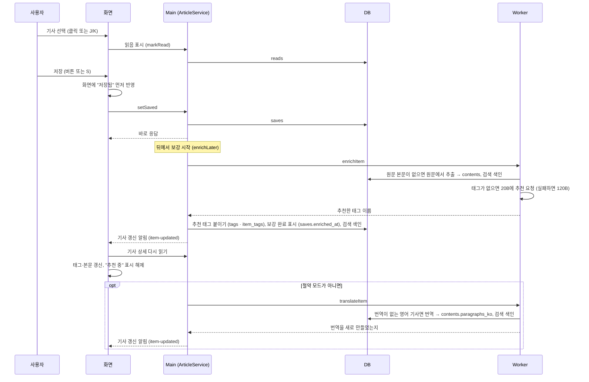

- **읽음·저장·메모·태그는 Main이 DB에 직접 씁니다.** `ArticleService`·`TagService`가 저장소로 처리하고 Worker를 거치지 않습니다.
- **저장은 기다리지 않습니다.** 저장 자체는 즉시 끝나고, 보강은 Main의 `ArticleService.enrichLater`가 뒤에서 진행합니다. 본문 추출·태그 추천은 Worker의 `EnrichmentService.enrichItem`이 하고, 본문 추출이나 태그 추천이 실패해도 오류 없이 빈 결과를 돌려줍니다. Main은 돌려받은 추천 태그를 앞에서 3개까지 `auto` 태그로 붙이고 보강 완료를 표시한 뒤(한 트랜잭션) 화면에 알립니다. Worker 호출 자체가 실패하면 진단 기록만 남기고 보강 완료로 표시하지 않아, 다음 저장·메모 때 다시 시도합니다.
- **보강 뒤 번역:** 절약 모드가 아니면 Main이 이어서 `translateItem`을 요청합니다. 번역이 끝나면 결과와 상관없이 화면에 `item-updated`를 보냅니다.
- **태그 추천:** 기존 태그 목록을 함께 보내서 같은 의미의 태그를 새로 만들지 않게 합니다. 사용자가 이미 태그를 붙였으면 추천하지 않습니다. 추천 태그도 직접 붙인 태그와 같은 이름 정리 규칙(`TagService.addTag`)을 거칩니다. 보강은 기사마다 한 번만 합니다(`saves.enriched_at`).
- **메모:** 입력을 멈추고 0.8초 뒤, 또는 입력란을 벗어나거나 다른 기사로 넘어갈 때 저장합니다(`MemoPad`). 메모를 쓰면 그 기사는 자동으로 저장되고 보강이 시작됩니다. 메모를 비우면 메모만 지우고 저장은 유지합니다.
- **태그 편집:** 직접 붙이거나 뗄 수 있습니다. 소문자·하이픈으로 정리하고, 하이픈만 다른 기존 태그가 있으면 그 표기를 씁니다. 아무 기사에도 안 쓰이게 된 태그는 지웁니다.
- **본문:** 읽기 화면은 기사 상세(`ArticleService.getItemDetail`)에서 문단 목록과 문단별 번역을 받아 ¶ 번호를 붙여 보여줍니다. 원문 추출에 실패한 기사는 그 사실을 표시합니다.
- **본문 보기 전환:** 번역이 있으면 본문 제목 옆에 [한국어 | 원문 | 함께 보기] 전환기가 나옵니다(T 키로 차례로 바꿈). 함께 보기는 번역 문단 아래에 원문을 작게 붙입니다. 마지막에 고른 방식은 이 PC에 기억합니다(`useBodyMode`). 번역하지 않은 문단은 원문으로 보여주고 그 개수를 알립니다.
- **열 때 번역:** 번역이 아직 없는 영어 기사(절약 모드였거나, 브리핑 밖에서 저장했거나, 번역이 실패한 기사)를 열면 화면이 번역을 요청합니다(`useAutoTranslate` → `ArticleService.translateItem` → Worker의 `TranslationService.translateItem`). 같은 기사를 이미 번역하는 중이면 새로 시작하지 않고 진행 중인 번역의 결과를 받습니다. 그동안 원문을 보여주며 "옮기는 중"을 알리고, 끝나면 그 자리에서 번역이 위에서부터 차례로 나타납니다. 기사마다 한 번만 자동 요청하고, 실패하면 "다시 시도" 버튼을 보여줍니다. 하루 사용 상한에 닿았으면 번역하지 않습니다.

#### 하이라이트
- **긋기:** 본문 문장을 드래그하면 선택 영역 위에 작은 막대(하이라이트 / 질문)가 뜹니다(`SelectionToolbar`). "하이라이트" 또는 `H`를 누르면 선택 영역을 문단별 위치로 바꿔(`domains/highlight/highlight.ts`의 `rangesFromSelection`) 저장합니다. 여러 문단에 걸치면 문단마다 하나씩 생깁니다. "질문"을 누르면 그 문장을 인용한 질문 초안이 질문 탭에 채워집니다.
- **번역문과 원문:** 문단마다 `data-para`(¶ 번호)와 `data-variant`(ko / original)가 붙어 있어 어느 판에 그었는지 함께 저장합니다.
- **보이는 모양:** 형광펜처럼 글자 아래쪽만, 끝이 둥글고 기울게, 가운데가 짙게 칠합니다(app.css의 `.marker`). 방금 그은 것은 왼쪽에서 오른쪽으로 그어지는 움직임이 있습니다. 메모를 붙인 하이라이트는 끝에 ✎ 표시가 붙습니다. 하이라이트가 있는 문단은 ¶ 옆 여백에 강조색 괘선이 그어지고, 지금 보이지 않는 판(번역문/원문)에만 있으면 괘선이 옅습니다.
- **메모 카드:** 본문의 하이라이트에 마우스를 올리면 작은 카드(`HighlightCard`)가 떠서 메모 보기·고치기, 이 부분 질문, 지우기를 바로 할 수 있습니다. 스크롤하거나 하이라이트와 카드 밖으로 나가면 닫히고, 문장을 드래그하는 중에는 뜨지 않습니다.
- **저장:** Main의 `HighlightService.addHighlights`가 보관된 본문에서 그 구간의 글자를 잘라 저장하고, 같은 문단·같은 판에서 겹치거나 맞닿으면 합칩니다. 긋기·기사 자동 저장·검색 색인 갱신은 한 트랜잭션입니다. 그어서 기사가 새로 저장됐으면 저장 후 보강이 시작됩니다.
- **하이라이트 탭:** 읽기 화면 옆 단의 "하이라이트 N" 탭에 본문 순서대로 모입니다(`HighlightList`). 인용문을 누르면 본문의 그 문단으로 가고(형광 잔상), 하이라이트마다 메모를 붙이고, "이 부분 질문"이나 지우기를 할 수 있습니다. 본문의 하이라이트를 누르면 탭에서 그 항목을 보여줍니다.
- **위치가 어긋날 때:** 본문을 다시 뽑거나 다시 번역하면 위치가 바뀔 수 있어, 저장된 위치의 글자가 다르면 그은 글자를 찾아 옮겨 칠합니다. 못 찾으면 탭 목록에만 남습니다.
- 하이라이트 글자와 메모는 검색 색인에 들어가서 라이브러리 검색으로 찾을 수 있습니다.

### 4.5 검색과 아카이브

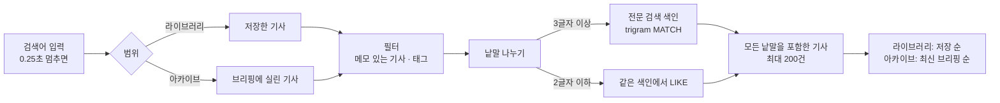

- 화면의 `SearchInput`이 입력을 잠깐 멈췄을 때만 검색합니다. 요청은 Main의 `SearchService.search`가 `SearchRepository.searchItems`로 DB에서 바로 읽습니다(Worker를 거치지 않음).
- 검색 대상은 제목(원제·한국어), 요약·핵심 포인트·본문·번역, 메모·하이라이트입니다. 색인은 기사 내용이 바뀔 때마다 그 기사만 다시 씁니다(3.4절).
- **아카이브:** 옆 패널 없이 날짜 목록(`DigestService.listDigests`: 날짜, 머리글, 기사 수, 그중 저장한 수)을 화면 폭 전체로 보여줍니다. J/K로 고르고 Enter나 "보기 →"로 그날의 브리핑을 오늘 화면과 같은 지면(`DigestView`)으로 엽니다.

### 4.6 AI 질문

기사 읽기 화면의 "질문" 단(또는 `/` 키)에서 기사 한 건에, 메뉴의 "질문" 화면에서 그날 브리핑 전체에 질문합니다.

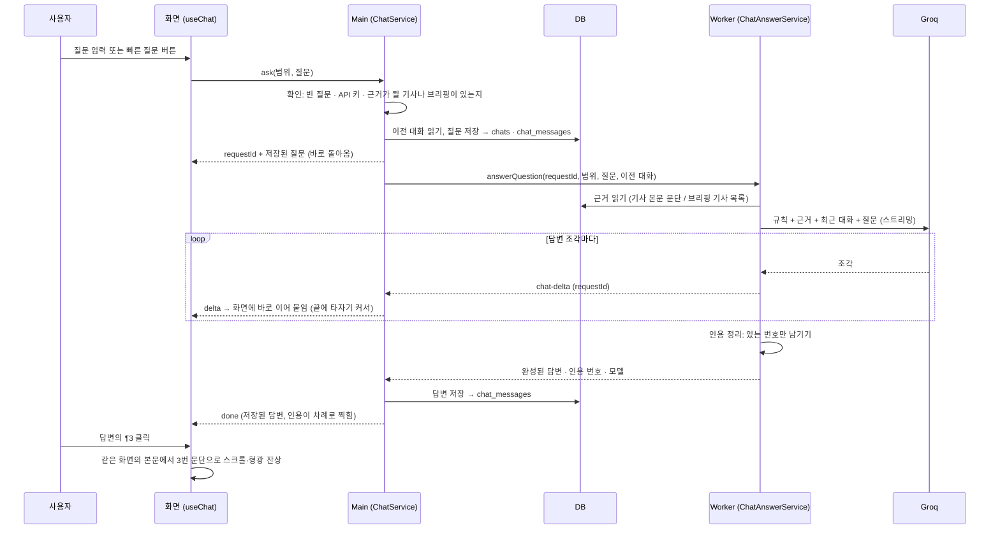

- **역할 나누기:** 대화(`chats`·`chat_messages`)는 Main의 `ChatService`가 읽고 씁니다. Worker의 `ChatAnswerService`는 답변을 만들기만 하고 질문·답변을 저장하지 않습니다. 이전 대화는 Main이 읽어서 호출에 실어 보냅니다.
- **받지 않는 질문:** 질문이 비었거나, API 키가 없거나, 근거가 될 기사·브리핑이 없으면 Main이 질문을 저장하지 않고 오류로 답합니다.
- **근거 만들기** (`src/worker/services/chat-answer-service.ts`)
  - 기사 채팅: 보관된 본문 문단마다 `[¶번호]`를 붙여 넘깁니다. 본문이 길면(약 36,000자 초과) 앞 3문단과 질문과 낱말이 많이 겹치는 문단만 고르고, 번호는 원래 번호를 유지합니다(`citations.ts`의 `selectParagraphs`). 저장하지 않은 기사는 브리핑 때 보관한 본문·요약을 씁니다.
  - 브리핑 채팅: 그날 실린 기사마다 `[#순위]`와 한국어 제목·분류·출처·요약·왜 중요한가를 넘깁니다.
- **프롬프트 규칙** (`config/prompts/chat-item.md`, `chat-digest.md`): 근거에서 가져온 문장 끝에 번호를 붙이기, 근거에 없는 것은 "기사에는 그 내용이 없습니다"라고 먼저 밝히고 일반 지식과 구분하기, 수치·통화 표기 그대로, 마크다운 쓰지 않기.
- **인용 정리** (`cleanCitations`): 답변이 끝나면 근거에 실제로 있는 번호만 남기고, 모델이 지어낸 번호는 지웁니다. 남은 번호 목록을 함께 저장합니다.
- **대화 이어가기:** Main이 넘긴 이전 대화 중 최근 10턴(질문·답 20개)을 함께 보냅니다. 규칙과 근거를 맨 앞에 두므로 같은 기사로 이어서 물으면 Groq 자동 캐싱으로 그 부분의 입력 비용이 절반이 됩니다.
- **모델과 비용:** `config/models.yaml`의 `chat` 역할(120B, 추론 low, 출력 최대 2,000토큰). 월 예산에 도달하면 절약 모드 모델(20B)로 답합니다. 하루 상한은 브리핑 생성만 막고 질문은 막지 않습니다. 호출마다 `llm_usage`에 `chat`으로 기록합니다. 질문 1건 약 $0.001 미만입니다.
- **답변 조각의 전달:** Worker의 답변 조각(`chat-delta`)은 Main의 `ChatService.forwardAnswerDelta`를 거쳐 열려 있는 창으로 방송되고, 화면(`useChat`)은 자기 질문의 requestId인 조각만 받습니다. 질문 응답보다 조각이 먼저 도착해도 잠시 모아 두었다가 이어 붙입니다.
- **빠른 질문:** `config/quick-actions.yaml`의 버튼(기사: 쉽게 설명·기술 디테일·내 일에 적용하면?·한계와 반론 / 브리핑: 꼭 읽을 3개·오늘의 흐름·바로 써볼 것). 버튼을 누르면 그 문장을 질문으로 보냅니다.
- **메모에 추가:** 답변 아래 버튼으로 그 답변을 기사 메모 끝에 덧붙입니다. 메모를 쓴 것과 같으므로 기사가 자동 저장되고 보강이 시작됩니다.
- **브리핑 채팅의 인용:** `#3`을 누르면 오늘 화면으로 가서 그 기사를 선택합니다(분류 필터는 풀림). 마우스를 올리면 기사 제목이 보입니다.
- **답변 실패:** Worker 호출이 실패하면 Main이 진단 기록을 남기고 화면에 오류를 알립니다. 저장한 질문은 대화에 남습니다.
- **대화 지우기:** 그 범위의 대화만 지웁니다.

### 4.7 설정과 API 키

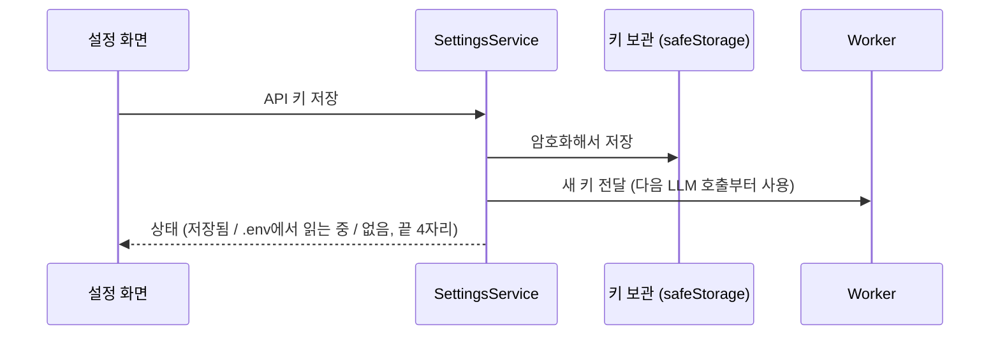

- **키 표시:** 키가 있으면 `gsk_****…끝4자리`처럼 가린 칸으로 보여주고, 그 칸이나 "변경"을 누르면 새 키를 입력하는 칸으로 바뀝니다(`ApiKeyField`, Esc·취소로 돌아감).
- **키 보관:** 입력한 키는 Windows 계정 단위로 암호화해 `groq-key.bin`에 저장합니다(`platform/secrets.ts`). 개발 중에는 저장된 키가 없으면 프로젝트의 `.env`를 읽습니다.
- **키 변경 반영:** 키를 저장하거나 지우면 SettingsService가 Worker에 곧바로 알려서, 앱을 다시 켜지 않아도 다음 호출부터 새 키를 씁니다. 지우면 `.env` 키로 돌아갑니다.
- **예산:** 월 예산·하루 상한·브리핑 크기는 Main의 `SettingsService`가 `settings` 테이블에 저장하고, Worker가 다음 생성부터 4.3절의 예산 확인에 읽어 씁니다. 저장하지 않은 항목의 기본값과 읽는 규칙은 두 프로세스가 `src/backend/domain/app-settings.ts`를 같이 씁니다. 메뉴 하단과 설정 화면의 이번 달 사용액은 Main이 `llm_usage`를 읽어 계산합니다(`src/backend/domain/usage.ts`의 `summarizeUsage`, Worker의 예산 확인과 같은 함수).
- **자동 시작:** Windows 로그인 항목에 등록합니다. 자동 시작으로 켜지면 창 없이 트레이에서 시작합니다.

### 4.8 앱 창과 트레이

- **제목 표시줄:** Windows 기본 테두리·제목 표시줄 없이(`frame: false`) 앱의 `TitleBar`(36px)가 그립니다.
  - 왼쪽: 신문 맨 윗줄처럼 날짜 · 제N호 · 기사 N건
  - 오른쪽: 상태(만드는 중 / 새 브리핑 / 연결 대기 중 / 생성 실패, 누르면 오늘 화면)와 직접 그린 창 버튼(최소화·최대화/복원·닫기)
  - 아래: 생성 중 진행선
  - 빈 곳을 끌면 창이 움직이고 더블클릭하면 최대화됩니다. 창이 비활성이면 글자와 버튼이 흐려집니다.
  - 창 버튼은 IPC(`window:*`)로 Main의 `MainWindow`(`WindowControls`)가 처리합니다. Windows 11 스냅 레이아웃 메뉴는 쓸 수 없고, Win+화살표·화면 가장자리로 끌기는 됩니다.
- **닫기:** 창을 닫아도 앱은 꺼지지 않고 트레이로 숨습니다. 종료는 트레이 메뉴의 "종료"로 합니다.
- **트레이:** 아이콘은 앱 아이콘과 같은 블랙레터 J에 상태 배지(만드는 중 속 빈 원 / 새 브리핑 강조색 원 / 오프라인 회색 원 / 실패 빨간 원+!)를 붙여 코드로 그립니다(`tray-icon.ts`, 화면 배율별 16·20·24·32px). 툴팁은 "Jogan · 상태"에 새 브리핑이면 오늘의 한 줄, 실패면 이유를 붙입니다. 아이콘을 누르면 오늘 화면을 열고 "새 브리핑" 배지를 거둡니다. 메뉴: 오늘 브리핑 열기, 지금 브리핑 만들기, 알림 테스트, Windows 시작 시 실행, 종료.
- **단축키 안내:** `?` 키나 메뉴 아래 "? 단축키"를 누르면 단축키 표가 뜹니다. `Ctrl+Alt+N`은 다른 프로그램을 쓰는 중에도 창을 엽니다.

### 4.9 출처 페이지

왼쪽 메뉴 아래쪽의 "출처"에서 어디서 자료를 받는지, 얼마나 받아서 얼마나 브리핑에 실리는지 봅니다(`SourcesPage`). 읽기 전용이고, 출처를 켜고 끄는 것은 `config/sources.yaml`에서 합니다.

- **기간:** 7일 / 30일 / 전체(기본 7일). 7일·30일을 고르면 그 기간 숫자를 크게, 전체 누적을 작게 함께 보여줍니다. 개수는 글을 수집한 시각 기준입니다.
- **흐름:** 수집 → 중복 합침 → AI 선별 → 브리핑에 실림 → 저장의 단계별 개수와 수집 대비 비율(`Funnel`). 같은 기간의 LLM 비용과 단계별(선별·묶기·중복 확인·요약·번역·머리글·태그·질문) 비용.
- **날마다:** 최근 30일, 날마다 수집한 글 수와 그날 브리핑에 실린 글 수를 나란히 막대로(`DailyBars`).
- **출처별 표:** 출처 이름·수집 방식, 상태(정상/실패 + 마지막 수집 시각, 기간 중 실패 횟수, 꺼짐, 기록 없음), 수집·실림·채택률·저장, 전체 누적(`SourceTable`). 열 머리로 정렬하고, 꺼진 출처는 맨 아래에 둡니다. 행을 누르면 수집 조건(`sources.yaml` 설정을 문장으로 풀어 쓴 것, `src/backend/config/index.ts`의 `describeSource`), 최근 수집 기록 10건, 최근 실린 기사 5건이 펼쳐집니다.
- **데이터:** Main의 `SourceStatsService.getSourceStats(기간)`이 `SourceFetchRepository`의 집계 조회(`items`·`digests`·`digest_entries`·`saves`·`source_fetches`)와 `LlmUsageRepository`의 비용 합계(`llm_usage`)를 읽고, 설정 파일의 출처 이름·수집 방식·조건을 붙여 조립합니다. 읽기만 합니다. 설정에서 빠진 옛 출처의 글도 흐름 합계에는 들어갑니다.
- **수집 기록:** 브리핑 생성과 미리 수집 때 Worker의 `CollectService.collectAndStore`가 출처마다 한 줄씩 `source_fetches`에 남깁니다. 이 기능을 넣기 전 기간은 상태가 "기록 없음"으로 나옵니다.

### 4.10 실패와 복구

| 상황 | 동작 |
|---|---|
| 로그인 직후 네트워크 없음 | 30초 간격으로 최대 5분 기다림(제목 표시줄 "연결 대기 중"). 끝내 안 되면 트레이 "오프라인", 다음 잠금 해제·로그인 때 다시 시도 |
| API 키 없음·잘못됨 | 생성 실패 알림 → 클릭하면 설정 화면. 오늘 화면에도 오류와 "설정으로 이동" 표시 |
| 하루 상한 도달 | 그날은 새로 만들지 않음(오류로 안내), 열 때 번역도 하지 않음 |
| 월 예산 도달 | 절약 모드로 계속 생성(작은 모델, 15건, 번역은 열 때) |
| 소스 하나 실패 | 나머지로 진행, 실패한 소스는 통계에 기록 |
| LLM 선별 일부 실패 | 성공한 배치로 진행. 전부 실패하면 생성 중단 |
| 묶기·중복 확인·요약·머리글 실패 | 묶지 않고 / 확인 없이 / 원제·RSS 요약으로 / 1위 제목으로 대신해 진행 |
| 본문 추출 실패 | 브리핑: 본문이 300자 미만이면 빼고 다음 후보로 채움. 저장한 기사: RSS 요약·초록으로 대신하고 "본문 없음" 표시 |
| 번역 실패 | 번역 없이 게시하고, 읽기 화면을 열 때 다시 시도("다시 시도" 버튼) |
| 질문 답변 실패 (네트워크·키) | 화면에 오류 표시. 질문은 대화에 남고 다시 물을 수 있음 |
| 저장 후 보강 실패 (Worker 호출 실패) | 진단 기록만 남김. 저장은 그대로이고, 보강 완료로 표시하지 않아 다음 저장·메모 때 다시 시도 |
| Worker 비정상 종료 | Main이 3초 뒤 다시 띄움. 진행 중이던 요청은 실패로 돌려주고, 다시 뜨기를 기다리는 동안 들어온 요청은 준비되면 보냄. 그동안에도 화면용 조회와 저장·메모·태그·하이라이트는 Main이 직접 처리 |
| Worker가 준비도 못 하고 연달아 3번 종료 (DB·설정 파일 오류 등) | 다시 띄우기를 그만두고, 이후 Worker 호출은 바로 실패로 답함 |
| Main 시작 실패 (DB 열기·스키마 변경 적용·설정 파일 읽기 오류 등) | 이유를 오류 창으로 알리고 종료 |
| 두 프로세스가 동시에 DB에 쓰려 함 | 뒤에 온 쪽이 5초까지 기다림 (3.6절) |
| 앱이 생성 도중 꺼짐 | 다음에 Worker가 시작할 때 `running`으로 남은 실행을 오류로 정리. 오늘 브리핑이 없으므로 다음 계기에 다시 생성 |

진단 화면(설정 → 진단 화면 열기)에서 트리거 기록, 알림 테스트, 네트워크 점검, 이벤트 기록을 볼 수 있습니다. 같은 기록이 `diagnostics.log`에도 남습니다.
